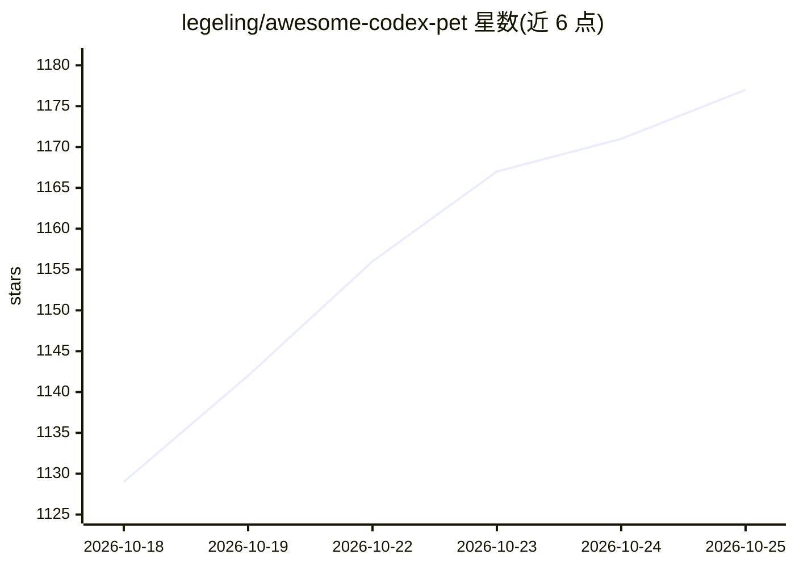

# legeling/awesome-codex-pet

⭐ 1,177 · TypeScript · MIT · 推送 2026-10-24 · [GitHub](https://github.com/legeling/awesome-codex-pet) · [官网](https://codexpet.top) · 个人维护 · 中文 README

**社区 Codex 桌宠策展目录：351 个像素宠物包，一键安装**

codexpet.top 背后的宠物资源源目录仓库：收录 351 个社区制作的 Codex 桌宠包（含精灵图、元数据与创作者署名），按游戏角色、动漫角色、原创角色、吉祥物等分类组织，提供 npx 一条命令安装（macOS/Linux/Windows 通用，无需克隆仓库），安装器校验 manifest 与 SHA-256 哈希。宠物资产遵循 CC BY-NC 4.0，代码为 MIT。贡献者可借助 Codex 创建、修复并提交宠物；Codex 内置 v1→v2 的 AI 辅助升级流程，生成 16 方向注视动画图集。

## 筛选速览

| 维度 | 判定 | 备注 |
|---|---|---|
| AI 角色 | `ai-knowledge` | 知识聚合/清单类 |
| 许可风险 | `permissive` | MIT |
| 部署形态 | `library` | 以包/库形式分发 |
| 模型依赖 | — | README 未给出锁定关系 |
| 硬件要求 | — | 无带数字的原话,不猜 |
| 安装摩擦 | `low` | 无编译、无系统依赖或容器化 |
| 成熟度 | — | 结构信号不足 |

## 能力要点

- 351 个宠物包、11 种语言命名，npx 一条命令跨平台安装
- 安装器验证 manifest 与 SHA-256，支持版本固定与可复现安装
- v1/v2 两种精灵图版本，v2 含 16 方向注视动画
- 支持无制图技能的角色请求，由社区志愿者认领制作

## 适用场景

- 给 Codex 挑选并一键安装喜欢的桌宠
- 提交角色请求让社区志愿者代做宠物
- 作为贡献者借助 Codex 制作并提交桌宠包

## 场景标签

`精选清单` · 领域:学习与行业

## 证据(README 行号)

> L13: pets: 351 categories: 11 languages: en | zh--CN | ko | ja | es code: MIT assets: CC BY--NC 4.0 install: one command
> L15: This repository is the source catalog behind codexpet.top: it keeps installable pet packages, creator attribution, 
> L19: - **One-command install** — no clone, no manual setup, works on macOS / Linux / Windows

## 星数曲线

2026-10-18 1,129 → 2026-10-25 1,177（+48）

---
*卡片 v1 · prompt 1.4 · 生成 2026-10-21 · 置信度 mid · 依据 README sha `91c605d25ec0` · [字段定义](../../DATASET.md)*
