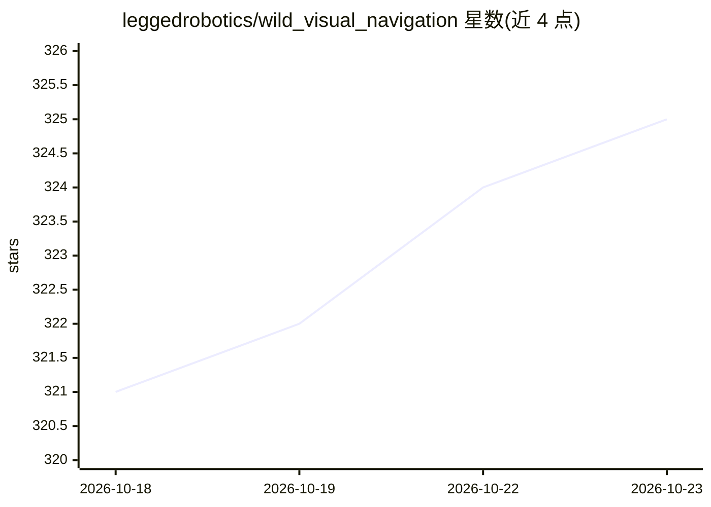

# leggedrobotics/wild_visual_navigation

⭐ 325 · Python · MIT · 推送 2026-05-27 · [GitHub](https://github.com/leggedrobotics/wild_visual_navigation) · [官网](https://sites.google.com/leggedrobotics.com/wild-visual-navigation) · 组织维护

**移动机器人视觉可通行性自监督在线学习系统**

实现论文 WVN（Frey & Mattamala 2023、Mattamala & Frey 2024）的系统：面向移动机器人的视觉自监督可通行性估计，在野外数分钟人类演示后即可在线训练。纯 Python 实现，提供仿真 Jackal 快速上手 demo（Docker 运行）、预训练模型推理脚本，以及 ANYmal/Jackal 机器人 ROS 1 集成包和 elevation_mapping_cupy 集成。完整部署需 ROS 1 Noetic 与 CUDA GPU。

## 筛选速览

| 维度 | 判定 | 备注 |
|---|---|---|
| AI 角色 | `ai-native` | 本体是模型或模型工具 |
| 许可风险 | `permissive` | MIT |
| 部署形态 | `self-host` | docker 或自建部署 |
| 模型依赖 | — | README 未给出锁定关系 |
| 硬件要求 | — | 无带数字的原话,不猜 |
| 安装摩擦 | `low` | 无编译、无系统依赖或容器化 |
| 成熟度 | — | 结构信号不足 |

## 能力要点

- 基于预训练模型与在线自监督的可通行性估计
- 数分钟人类演示后即可在线训练
- 提供 ANYmal 与 Jackal 的 ROS 1 集成包
- Docker 快速上手 demo 与预训练模型推理脚本

## 适用场景

- 让足式/轮式机器人在野外地形学习可通行性
- 用预训练模型对图像快速推理可通行性
- 基于 ANYmal rosbag 复现在线训练与适配

## 场景标签

 · 领域:机器人/自主导航

## 证据(README 行号)

> L15: This package implements the Wild Visual Navigation (WVN) system presented in Frey & Mattamala et al. "Fast Traversa
> L21: - Quick start demos for online training in simulation, as well as scripts for inference using pre-trained models

## 星数曲线

2026-10-18 321 → 2026-10-23 325（+4）

---
*卡片 v1 · prompt 1.4 · 生成 2026-10-21 · 置信度 high · 依据 README sha `a3cb041a34f4` · [字段定义](../../DATASET.md)*
