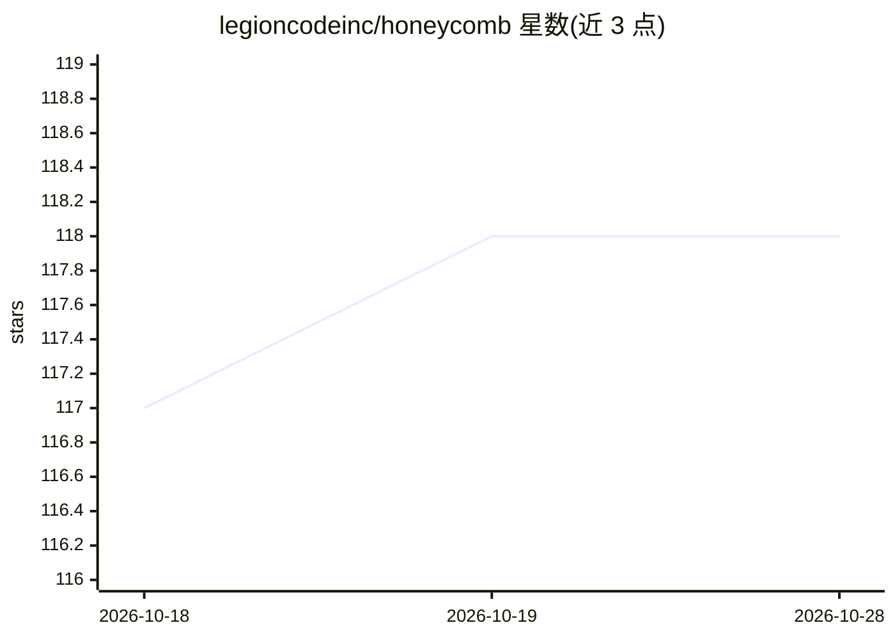

# legioncodeinc/honeycomb

⭐ 118 · TypeScript · AGPL-3.0 · 推送 2026-10-04 · [GitHub](https://github.com/legioncodeinc/honeycomb) · [官网](https://www.theapiary.sh) · 组织维护

**给 AI 编程代理的跨工具共享持久记忆层**

为 Claude Code、Cursor 等 AI 编程代理提供共享持久记忆：本地守护进程通过各工具的钩子捕获每轮对话，蒸馏为 key/summary/raw 三层记忆，存储于 Deeplake（也可自托管 pg_deeplake），并以会话预注入、混合检索（BM25+向量 RRF 融合）与知识图谱向任意工具回溯。支持从会话中挖掘可复用技能并在团队间同步。一条命令安装 CLI、守护进程与仪表盘，需 Deeplake 凭据。

## 筛选速览

| 维度 | 判定 | 备注 |
|---|---|---|
| AI 角色 | `ai-ecosystem` | LLM/agent 周边工具 |
| 许可风险 | `viral` | AGPL-3.0 |
| 部署形态 | `library` | 以包/库形式分发 |
| 模型依赖 | — | README 未给出锁定关系 |
| 硬件要求 | — | 无带数字的原话,不猜 |
| 安装摩擦 | `low` | 无编译、无系统依赖或容器化 |
| 成熟度 | — | 结构信号不足 |

## 能力要点

- 本地守护进程捕获各 harness 每轮对话并蒸馏为三层记忆（key/summary/raw）
- 跨工具/设备/团队成员共享同一记忆，写入一处各处可召回
- 会话挖掘可复用技能并自动同步给团队
- BM25+768 维向量 RRF 融合检索，recall@5 约 0.72-0.78

## 适用场景

- 在不同 AI 编程工具和设备间保留项目决策与约定
- 团队共享同一个记忆库，避免重复踩坑
- 自动从历史会话沉淀并分发可复用技能

## 场景标签

`Agent 记忆` · 领域:Agent 开发

## 证据(README 行号)

> L5:  Shared, persistent memory for your AI coding agents.
> L33: AI coding agents forget. They forget across sessions, and they forget across tools. A decision you reached in Claud
> L132: Honeycomb is a long-lived local **daemon** plus thin clients. The daemon is the *only* process that talks to stora

## 星数曲线

2026-10-18 117 → 2026-10-28 118（+1）

---
*卡片 v1 · prompt 1.4 · 生成 2026-10-23 · 置信度 high · 依据 README sha `984a56b20fbc` · [字段定义](../../DATASET.md)*
