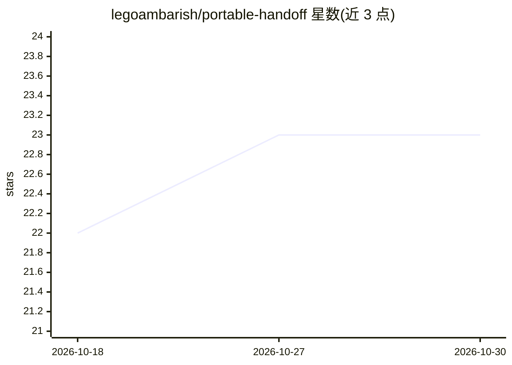

# legoambarish/portable-handoff

⭐ 23 · Python · Apache-2.0 · 推送 2026-09-08 · [GitHub](https://github.com/legoambarish/portable-handoff) · 个人维护

**在 AI 编码代理与会话间携带项目上下文的胶囊工具**

面向使用编码代理（Claude Code、Codex CLI、Cursor 等）的开发者：把一个会话的工作上下文写成单个 Markdown 胶囊文件，模型提供语义、本地代码提供事实——git 状态、文件哈希、时间戳来自本机而非模型回忆，每条声明标注来源与信任级别。CLI 负责 preflight/finalize/load/validate，加载时校验 SHA-256 摘要、JSON 一致性与仓库状态，输出 staleness 分级；完整性失败的胶囊被拒绝而非修复。无任何运行时依赖、无网络、无 API key，需要文件系统与 shell。v0.1 无同步、账号与团队功能，语义质量取决于做压缩的模型。

## 筛选速览

| 维度 | 判定 | 备注 |
|---|---|---|
| AI 角色 | `ai-ecosystem` | LLM/agent 周边工具 |
| 许可风险 | `permissive` | Apache-2.0 |
| 部署形态 | `library` | 以包/库形式分发 |
| 模型依赖 | — | README 未给出锁定关系 |
| 硬件要求 | — | 无带数字的原话,不猜 |
| 安装摩擦 | `low` | 无编译、无系统依赖或容器化 |
| 成熟度 | `idea` | |

## 能力要点

- 胶囊文件：模型写语义 + 本地 git 事实合并，冲突时本地覆盖模型
- 每条声明带 provenance/trust 标签，trust:verified 需确定性来源
- load 时校验 SHA-256 摘要与 JSON 一致性，输出 fresh/stale 等六档 staleness
- 安全模型：胶囊中命令永不执行、密钥先脱敏、清除终端控制与双向 Unicode

## 适用场景

- 切换编码代理工具时把项目上下文带到新会话，不用重新解释
- 上下文窗口填满后压缩会话成果并保留可验证的仓库事实
- 把胶囊导出为 prose 粘贴到无 shell 的纯聊天会话

## 场景标签

`Agent 记忆` · 领域:Agent 开发

## 证据(README 行号)

> L15: Portable Handoff writes a capsule instead: one Markdown file where the model
> L186: Portable Handoff needs a filesystem and a shell. It works in Claude Code,

## 星数曲线

2026-10-18 22 → 2026-10-30 23（+1）

---
*卡片 v1 · prompt 1.4 · 生成 2026-10-27 · 置信度 high · 依据 README sha `810694702abc` · [字段定义](../../DATASET.md)*
