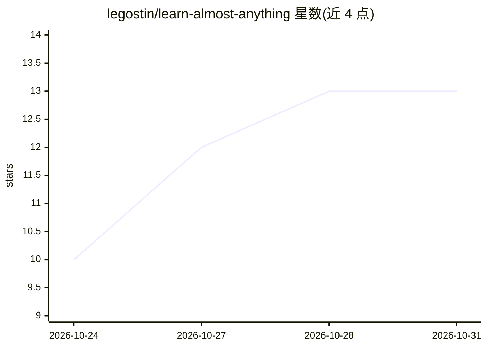

# legostin/learn-almost-anything

⭐ 13 · TypeScript · 推送 2026-07-01 · [GitHub](https://github.com/legostin/learn-almost-anything) · [官网](https://github.com/legostin/learn-almost-anything/releases) · 个人维护

**本地桌面 AI 导师：把任意主题生成为含测验作业的完整课程**

基于 Tauri 2 + React 的桌面应用，将用户输入的主题转化为结构化课程：agent 访谈、调研、设计大纲，生成带插图和交互组件的课文、理解测验、作业批改（含可运行的编程作业自动评分）与间隔重复闪卡，并可用系统语音或 Gemini TTS 生成讲授课音频。LLM 调用全部经由本机已登录的 Claude Code CLI 或 Codex CLI 完成，无需自有付费后端；数据存储在本地。支持私有文档 Space 接地、MCP 服务器、公共/私有课程目录与 MCP 课程生成。UI 提供英语和俄语。

## 筛选速览

| 维度 | 判定 | 备注 |
|---|---|---|
| AI 角色 | `ai-native` | 本体是模型或模型工具 |
| 许可风险 | `none` | — |
| 部署形态 | `desktop` | 安装包/桌面程序 |
| 模型依赖 | locked-api |  |
| 硬件要求 | — | 无带数字的原话,不猜 |
| 安装摩擦 | `low` | 无编译、无系统依赖或容器化 |
| 成熟度 | — | 结构信号不足 |

## 能力要点

- 课程生成闭环：课文、测验、作业批改、闪卡间隔重复与 TTS 讲授
- LLM 调用经由本机 Claude Code / Codex CLI，应用本身免费无付费后端
- 私有课程目录服务器（单条 Docker 命令部署）与课程翻译/安装
- 内置 laa-course MCP 服务器，可从 Claude Code 直接创作并发布课程

## 适用场景

- 把想学的任意主题生成为带测验和作业的完整课程自学
- 团队在内网自建课程目录，共享入职培训与领域知识课程
- 用自己的文档和仓库作为课程依据做接地生成

## 场景标签

`教程课程` · 领域:学习与行业

## 证据(README 行号)

> L17: Learn (Almost) Anything turns "I want to understand X" into an actual course: an agent interviews you, researches t
> L3: > Type a topic. Get a real course — with lessons, diagrams, tests, homework and spaced review — built by the AI subs
> L111: You pick one agent (Claude or Codex) when creating the course; every LLM step then runs through it via a local Nod

## 星数曲线

2026-10-24 10 → 2026-10-31 13（+3）

---
*卡片 v1 · prompt 1.4 · 生成 2026-10-31 · 置信度 mid · 依据 README sha `65d14bf4b725` · [字段定义](../../DATASET.md)*
