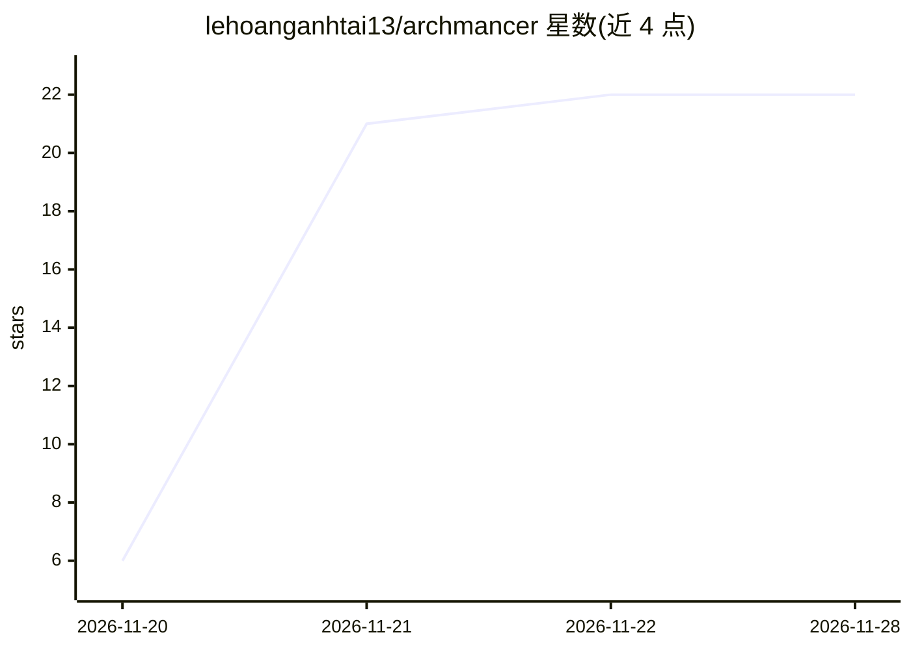

# lehoanganhtai13/archmancer

⭐ 22 · Apache-2.0 · 推送 2026-11-19 · [GitHub](https://github.com/lehoanganhtai13/archmancer) · 个人维护

**为编码 agent 提供 agent 系统架构技能的插件包（8 个技能）**

以 Agent Skills 格式打包的 8 个技能集合，通过 Claude Code / Codex 插件市场或 npx skills CLI 安装到编码 agent 中。内容覆盖 agent 系统的十项职责：入口技能映射整个系统的责任与检查点，组件技能分别讲授 harness 模型与工具、运行时交互、配置交付、上下文与状态、证据与检索、诊断评测、信任与隐私。用于设计、扩展、调试、优化、加固和迁移调用 LLM 的软件。README 说明技能仅在 Claude Code 与 Codex 上测试过。

## 筛选速览

| 维度 | 判定 | 备注 |
|---|---|---|
| AI 角色 | `ai-knowledge` | 知识聚合/清单类 |
| 许可风险 | `permissive` | Apache-2.0 |
| 部署形态 | `library` | 以包/库形式分发 |
| 模型依赖 | — | README 未给出锁定关系 |
| 硬件要求 | — | 无带数字的原话,不猜 |
| 安装摩擦 | `low` | 无编译、无系统依赖或容器化 |
| 成熟度 | — | 结构信号不足 |

## 能力要点

- 8 个 Agent Skills 格式技能，覆盖设计/调试/评测/安全等组件
- 三种安装途径：Claude Code 插件、Codex 插件、npx skills CLI
- 入口技能将任务路由到组件技能与章节
- 可选路由行写入 CLAUDE.md/AGENTS.md 触发加载

## 适用场景

- 设计一个基于知识库回答并可限额退款的客服 agent
- 为现有助手添加工具及其权限与失败检查
- 追踪 agent 重复执行外部操作的第一次分歧点
- 评审文档读取 agent 的提示注入与未授权工具调用

## 场景标签

`编码 Agent` `Agent 框架` `RAG` `模型评测` · 领域:Agent 开发

## 证据(README 行号)

> L10: Give your coding agent an architect's view of agent systems: software where a model chooses the next call or action
> L83: The repository holds one plugin package each for Claude Code and Codex, and a `skills/` folder in the Agent Skills 
> L117: Skills install under their own names, for example `agent-system-engineering`, without the `archmancer:` prefix. Th

## 星数曲线

2026-11-20 6 → 2026-11-28 22（+16）

---
*卡片 v1 · prompt 1.4 · 生成 2026-11-20 · 置信度 high · 依据 README sha `c0bb7be2d65d` · [字段定义](../../DATASET.md)*
