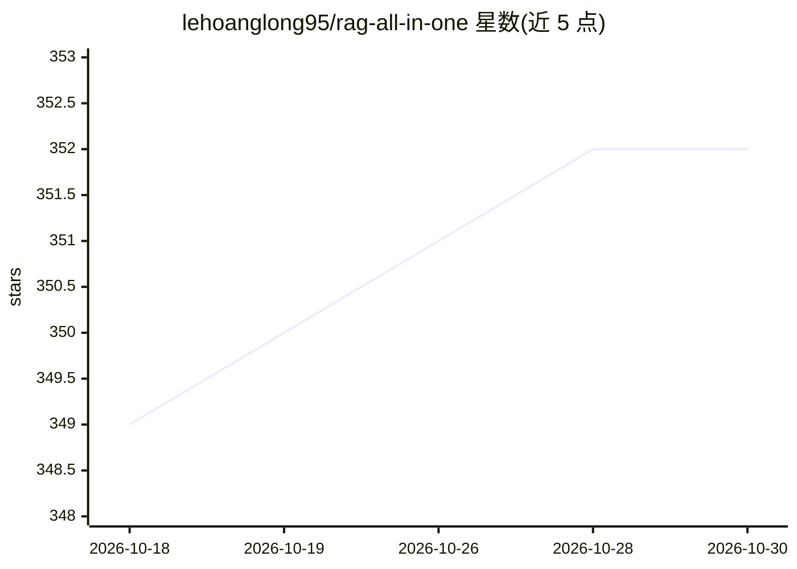

# lehoanglong95/rag-all-in-one

⭐ 352 · 推送 2026-05-20 · [GitHub](https://github.com/lehoanglong95/rag-all-in-one) · [官网](https://www.linkedin.com/in/long-le-713b41111/) · 个人维护

**RAG 应用构建指南：按组件分类的工具与课程资源清单**

个人维护的 RAG（检索增强生成）资源聚合仓库：按 RAG 架构的关键组件组织内容，包括课程与书籍、文档摄取、分块技术、检索、查询变换、Agent 框架、向量数据库等类别；每类以表格列出条目、描述与外链，部分附带代码示例。定位为帮助开发者发现 RAG 流水线各环节相关技术的集中目录，本体不含可运行代码。

## 筛选速览

| 维度 | 判定 | 备注 |
|---|---|---|
| AI 角色 | `ai-knowledge` | 知识聚合/清单类 |
| 许可风险 | `none` | — |
| 部署形态 | `None` |  |
| 模型依赖 | — | README 未给出锁定关系 |
| 硬件要求 | — | 无带数字的原话,不猜 |
| 安装摩擦 | `low` | 无编译、无系统依赖或容器化 |
| 成熟度 | — | 结构信号不足 |

## 能力要点

- 按 RAG 架构组件组织 16 类资源条目
- 收录 12 门课程、6 本书籍及各环节工具库
- 分块与检索技术条目附实现要点说明

## 适用场景

- 入门 RAG 时按组件查找课程与学习材料
- 为 RAG 流水线各环节选型工具库和数据库
- 了解分块、检索、查询变换等技术的实现方式

## 场景标签

`精选清单` · 领域:学习与行业

## 证据(README 行号)

> L14: RAG All-in-one is a guide to building Retrieval-Augmented Generation (RAG) applications. It offers a comprehensive 
> L22: |Component|Description|

## 星数曲线

2026-10-18 349 → 2026-10-30 352（+3）

---
*卡片 v1 · prompt 1.4 · 生成 2026-10-21 · 置信度 high · 依据 README sha `ec965ae29111` · [字段定义](../../DATASET.md)*
