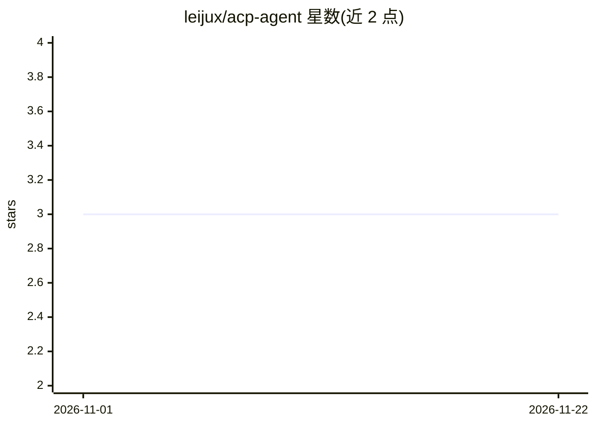

# leijux/acp-agent

⭐ 3 · Go · 推送 2026-11-14 · [GitHub](https://github.com/leijux/acp-agent) · [官网](https://github.com/leijux/acp-agent/releases) · 个人维护 · 中文 README

**Go 编写的单文件终端编码 agent：内置 shell/JS 与上下文压缩**

用 Go 与 goja 实现的单文件终端编码 agent，不依赖 bash、coreutils、Node 或 Python：agent loop 与工具契约对齐 Pi，内置纯 Go shell 解释器与进程内 JavaScript 执行，上下文压缩由 billion-context/kernel 在进程内完成（分块、BM25 检索、摘要标签）。提供 ACP v1 服务端可被 Zed 等接入，支持三档权限、MCP 工具加载、子代理委派与 TUI 交互，也可作为 Go 库使用。Windows 上无需额外运行时环境。

## 筛选速览

| 维度 | 判定 | 备注 |
|---|---|---|
| AI 角色 | `ai-ecosystem` | LLM/agent 周边工具 |
| 许可风险 | `none` | — |
| 部署形态 | `desktop` | 安装包/桌面程序 |
| 模型依赖 | locked-api |  |
| 硬件要求 | — | 无带数字的原话,不猜 |
| 安装摩擦 | `low` | 无编译、无系统依赖或容器化 |
| 成熟度 | — | 结构信号不足 |

## 能力要点

- 内置 mvdan/sh 纯 Go shell 解释器，Windows 无需 bash/coreutils
- goja 进程内执行 JS，并驱动上下文压缩（billion-context/kernel）
- ACP v1 服务端，兼容 Pi 协议族，MCP 与 skills 按路径自动加载
- 权限三档（ask/auto/readonly）+ 路径锁定 + 危险命令拦截

## 适用场景

- 在 Windows 纯环境（无 bash/Node/Python）下运行终端编码 agent
- 为 Multica 等 Pi 协议编排器提供可替换的 agent 运行时
- 在 Zed 等编辑器中通过 ACP 接入编码 agent
- 作为 Go 库嵌入自有应用并复用其上下文压缩 kernel

## 场景标签

`编码 Agent` · 领域:编码与开发

## 证据(README 行号)

> L3: **单文件、无 cgo、无 Node 的终端编码 agent**：Pi 风格的 agent loop + 完整工具集 + 进程内上下文压缩 + OpenAI 兼容 Provider + ACP 协议服务。
> L30: - agent loop、工具契约、会话 entry 树、`-p --mode json` 事件流、`--list-models` 都对得上 Pi，Multica 这类编排器按「Pi 协议族」接入即可，不需要改协议。

## 星数曲线

2026-11-01 3 → 2026-11-22 3（+0）

---
*卡片 v1 · prompt 1.4 · 生成 2026-11-21 · 置信度 high · 依据 README sha `396143f4d06e` · [字段定义](../../DATASET.md)*
