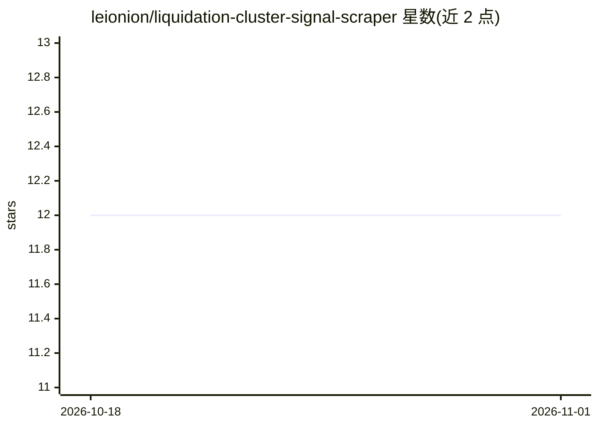

# leionion/liquidation-cluster-signal-scraper

⭐ 12 · Python · 推送 2026-03-16 · [GitHub](https://github.com/leionion/liquidation-cluster-signal-scraper) · 个人维护

**监控清算热力图与持仓量、预警轧空轧多的加密交易信号机器人**

本地运行的 Python 加密交易信号工具：通过交易所 WebSocket/REST 读取持仓量、用 Selenium 抓取 Coinglass 等清算热力图 DOM 数据，按集群密度、价格接近度与 OI 加速度生成轧空/轧多信号并输出置信分，支持纸面模式（不下单、无需 API key）与 config.yaml 阈值配置。面向期货交易者与量化交易者。公开版仅控制台输出；Telegram/Discord 推送、多资产并行与 ML 评分属于私有付费版本。OKX 支持标注为开发中。

## 筛选速览

| 维度 | 判定 | 备注 |
|---|---|---|
| AI 角色 | `ai-enhanced` | 去掉 AI 部分产品仍成立 |
| 许可风险 | `none` | — |
| 部署形态 | `library` | 以包/库形式分发 |
| 模型依赖 | — | README 未给出锁定关系 |
| 硬件要求 | — | 无带数字的原话,不猜 |
| 安装摩擦 | `low` | 无编译、无系统依赖或容器化 |
| 成熟度 | — | 结构信号不足 |

## 能力要点

- 清算集群密度 + OI 加速度 + 价格距离合成置信分
- 区分轧空（short squeeze）与轧多（long squeeze）设置
- 纸面模式跑完整信号管线且无需交易所密钥
- 支持 Binance/Bybit（稳定）与 OKX（开发中）

## 适用场景

- 盯盘时收到轧空/轧多临近的自动预警，替代手动看热力图
- 把 JSON 信号接入自己的算法交易系统作为信号源
- 纸面模式先验证信号质量再决定是否实盘

## 场景标签

`金融量化` · 领域:学习与行业

## 证据(README 行号)

> L7: **Liquidation Cluster Signal Scraper** is an open-source **crypto trading signal tool** that detects potential **sho
> L88: |Push alerts (Telegram/Discord)|❌|❌|❌|🔒 Private build|

## 星数曲线

2026-10-18 12 → 2026-11-01 12（+0）

---
*卡片 v1 · prompt 1.4 · 生成 2026-11-01 · 置信度 low · 依据 README sha `d4aa5bf07506` · [字段定义](../../DATASET.md)*
