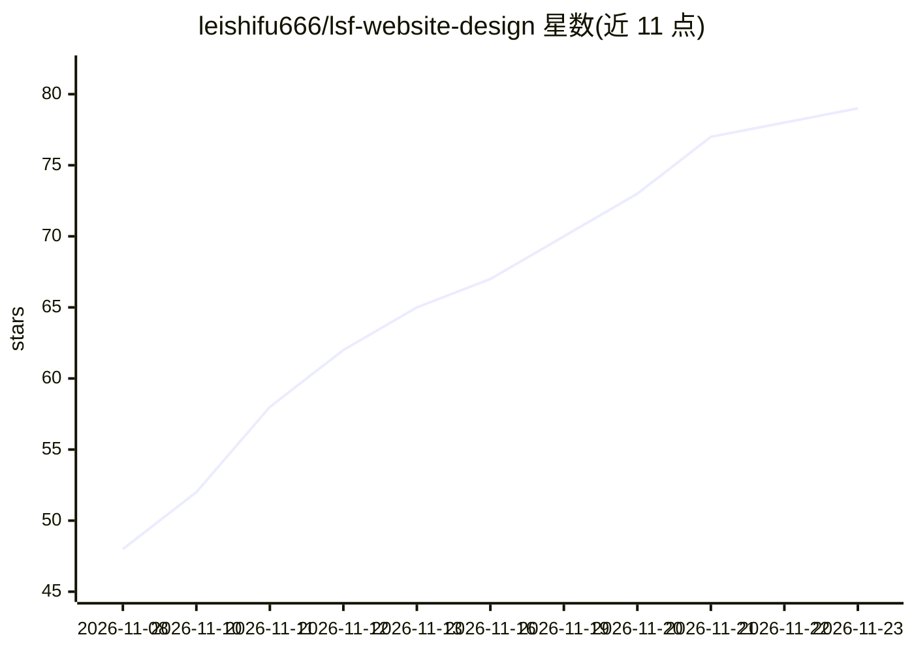

# leishifu666/lsf-website-design

⭐ 79 · JavaScript · MIT · 推送 2026-11-22 · [GitHub](https://github.com/leishifu666/lsf-website-design) · 个人维护 · 中文 README

**给 AI 编程助手的网站设计 skill：参考研究、制作与评审**

面向支持本地 skill 的 AI 编程助手的网站设计技能包：通过 SKILL.md 入口组织 A-H 七种模式，覆盖参考站研究、风格迁移建站、原创探索、找参考、反推提示词、视觉与文案评审。A 模式先实测原站六类行为再做可操作样段，样段通过后展开整站；配合 node 脚本做模式导航与资源索引（发布时 70 项回归测试通过）。依赖宿主提供的模型、生图与浏览器能力，自带三个免费配套组件要求；不自带模型服务或 API 密钥。

## 筛选速览

| 维度 | 判定 | 备注 |
|---|---|---|
| AI 角色 | `ai-ecosystem` | LLM/agent 周边工具 |
| 许可风险 | `permissive` | MIT |
| 部署形态 | `None` |  |
| 模型依赖 | — | README 未给出锁定关系 |
| 硬件要求 | — | 无带数字的原话,不猜 |
| 安装摩擦 | `low` | 无编译、无系统依赖或容器化 |
| 成熟度 | — | 结构信号不足 |

## 能力要点

- A-H 七种模式覆盖参考创作、原创探索、反推提示词与独立评审
- A 模式包含原站行为实测、样段对照、整站展开的三阶段流程
- node 脚本支持模式/阶段导航与资源索引校验（70 项回归测试）
- MIT 许可，附多模型成品截图展示

## 适用场景

- 让 AI 助手参考目标网站风格制作新主题网站
- 对已有页面做独立视觉与文案评审
- 分析参考网站并反推建站提示词

## 场景标签

`提示工程` · 领域:Agent 开发

## 证据(README 行号)

> L8: 给 AI 编程助手使用的网站设计 skill：从参考站研究、版式与动效制作，到实际浏览器核验和独立评审。
> L129: `lsf-web-*`调用名保留兼容，薄入口可按脚本说明生成。仅分析、提示词、评审不自动串联网站制作。子代理、外部模型、图片生成和浏览器能力以宿主实际提供为准；本技能不自带模型服务或 API 密钥。

## 星数曲线

2026-11-08 48 → 2026-11-23 79（+31）

---
*卡片 v1 · prompt 1.4 · 生成 2026-11-18 · 置信度 high · 依据 README sha `b400873c75b7` · [字段定义](../../DATASET.md)*
