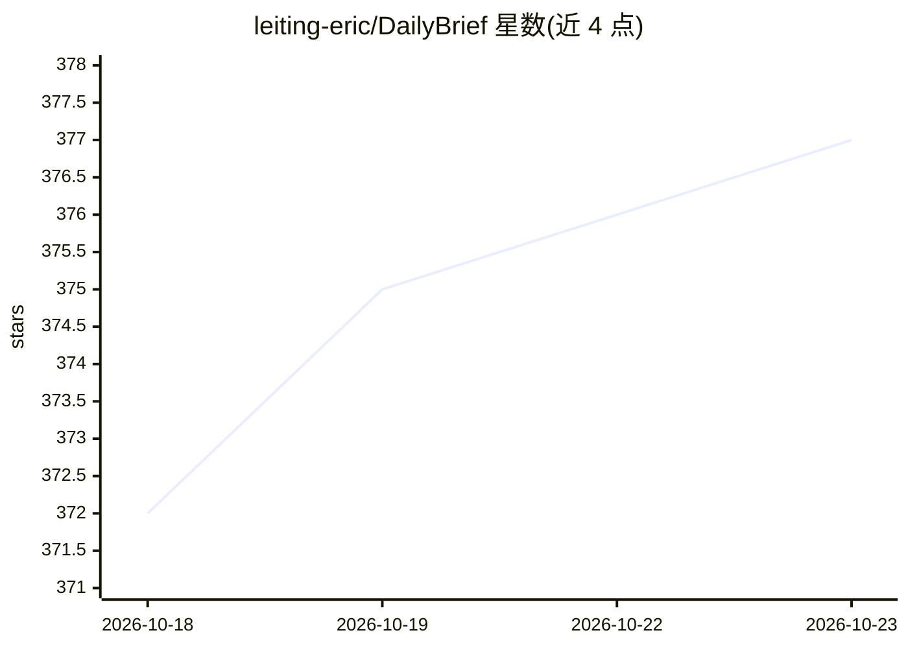

# leiting-eric/DailyBrief

⭐ 377 · TypeScript · MIT · 推送 2026-10-21 · [GitHub](https://github.com/leiting-eric/DailyBrief) · [官网](https://leiting-eric.github.io/DailyBrief/) · 个人维护 · 中文 README

**自托管 AI 每日新闻简报生成器：多源聚合 + LLM 中文摘要 + 行情分析**

TypeScript/Node 20+ 项目，聚合 53 个注册数据源（默认启用 26 个），覆盖 GitHub Trending、X 推文、AI 媒体、国际时政、财经与中文社区，配合 LLM 生成中英双语单文件 HTML 每日简报；另对 21 个股票/加密/外汇标的计算 SMA/RSI/MACD 技术指标并生成 LLM 交易点评。LLM 后端 6 种可插拔（Claude CLI/Anthropic/OpenAI/DeepSeek/MiniMax/Zhipu 及 OpenAI 兼容中转）。提供 GitHub Actions、本地一键脚本、AI Agent 代装三种部署方式，数据源经 sources.config.json 配置，无需改代码。

## 筛选速览

| 维度 | 判定 | 备注 |
|---|---|---|
| AI 角色 | `ai-native` | 本体是模型或模型工具 |
| 许可风险 | `permissive` | MIT |
| 部署形态 | `library` | 以包/库形式分发 |
| 模型依赖 | local-ok | 支持本地模型 |
| 硬件要求 | — | 无带数字的原话,不猜 |
| 安装摩擦 | `low` | 无编译、无系统依赖或容器化 |
| 成熟度 | — | 结构信号不足 |

## 能力要点

- 53 个注册数据源，默认启用 26 个，覆盖科技/AI/财经/时政/中文社区
- 21 个标的的 SMA/RSI/MACD 技术指标 + LLM 交易点评
- 6 个 LLM 后端一个环境变量切换，支持 OpenAI 兼容中转与本地 Ollama/LM Studio
- GitHub Actions / 本地一键脚本 / AI Agent 代装三种部署方式，中英双语输出

## 适用场景

- 每天早上自动收到一份覆盖科技与财经的多源新闻简报
- 自托管替代第三方阅读服务，掌控自己的阅读数据
- 跟踪美股/加密/外汇标的并获取带技术指标的 AI 点评

## 场景标签

`网页抓取` `AI 写作` `金融量化` · 领域:效率与自动化

## 证据(README 行号)

> L13: > **你的私人 AI 每日简报，跑在你自己掌控的基础设施上。** 默认启用 26 个数据源 · LLM 摘要 · 21 个股票/加密标的**技术指标 + AI 交易点评** · 中英双语 · 6 个 LLM 后端可选。
> L25: - **📈 21 个标的实时行情**：美股 / 加密 / 港股 / 商品外汇 / 宏观信号，附 SMA / RSI / MACD 技术指标 + LLM 每日交易点评
> L26: - **🤖 6 个 LLM 后端可插拔**：Claude CLI / Anthropic / OpenAI / DeepSeek / MiniMax / Zhipu，一个环境变量切换，不绑死任何家

## 星数曲线

2026-10-18 372 → 2026-10-23 377（+5）

---
*卡片 v1 · prompt 1.4 · 生成 2026-10-21 · 置信度 high · 依据 README sha `52aa7ae7514e` · [字段定义](../../DATASET.md)*
