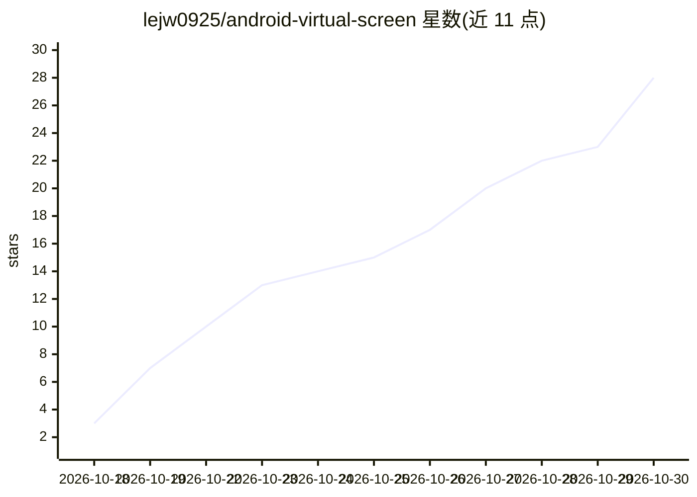

# lejw0925/android-virtual-screen

⭐ 28 · Kotlin · NOASSERTION · 推送 2026-10-24 · [GitHub](https://github.com/lejw0925/android-virtual-screen) · 个人维护 · 中文 README

**给 AI Agent 用的 Android 独立虚拟屏与认证 MCP 控制服务**

Android 应用：为本机 AI Agent 创建独立虚拟显示，Agent 可在虚拟屏中发现、启动和操作应用，手机主屏保持可用；用户可通过画中画预览、通知接管并随时撤销远程控制。内置 19 个 MCP 工具（控制权、显示、应用、观察、输入、条件等待），MCP 请求需 Bearer Token 认证，操作受独占租约约束。权限后端支持 Root su 或 Shizuku/Stellar，连接方式含回环、局域网、frpc 与 Cloudflare Tunnel。要求 Android 13+，采用 PolyForm Noncommercial 许可，禁止商用。

## 筛选速览

| 维度 | 判定 | 备注 |
|---|---|---|
| AI 角色 | `ai-ecosystem` | LLM/agent 周边工具 |
| 许可风险 | `none` | NOASSERTION |
| 部署形态 | `None` |  |
| 模型依赖 | — | README 未给出锁定关系 |
| 硬件要求 | — | 无带数字的原话,不猜 |
| 安装摩擦 | `medium` | 含编译或系统依赖之一 |
| 成熟度 | — | 结构信号不足 |

## 能力要点

- 为 Agent 建立独立虚拟显示，输入严格限定在虚拟屏内
- 19 个 MCP 工具，含观察 ID 与会话回执以拒绝过期操作
- Bearer Token 认证与独占租约，手机端可随时接管撤销远程控制
- 支持 Root / Shizuku / Stellar 后端与 frpc、Cloudflare Tunnel 连接

## 适用场景

- 让 AI Agent 在独立虚拟屏上操作安卓应用而不干扰主屏使用
- 通过手机随时查看 Agent 操作进度并接管控制
- 以带认证的 MCP 服务把安卓设备接入 Agent 工作流

## 场景标签

`GUI 自动化` · 领域:效率与自动化

## 证据(README 行号)

> L11: 虚拟屏是一款 Android 应用，为 AI Agent 建立独立虚拟显示，并在手机上运行经过认证的 MCP 服务。Agent 可以在虚拟屏中发现、启动和操作应用；你可以继续使用手机主屏，并随时查看、接管或停止操作。
> L26: - **19 个 MCP 工具**：覆盖控制权、显示、应用、观察、输入和条件等待。树观察可以省略截图；新鲜观察 ID 和会话回执用于拒绝过期操作、查询不确定结果而不重放输入。
> L59:     agent[AI Agent / MCP 客户端]

## 星数曲线

2026-10-18 3 → 2026-10-30 28（+25）

---
*卡片 v1 · prompt 1.4 · 生成 2026-10-28 · 置信度 high · 依据 README sha `151f1fb1b220` · [字段定义](../../DATASET.md)*
