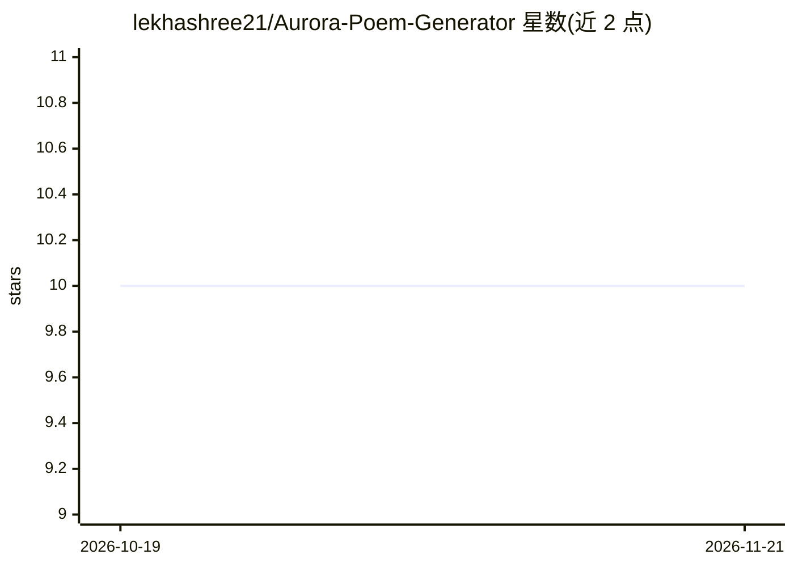

# lekhashree21/Aurora-Poem-Generator

⭐ 10 · TypeScript · 推送 2026-09-09 · [GitHub](https://github.com/lekhashree21/Aurora-Poem-Generator) · 个人维护

**面向消费者的 AI 诗歌生成 Web 应用**

基于 Next.js 的诗歌生成应用：用户选择自然、宇宙、爱情、神秘、海洋五个预设主题或输入自定义提示词，由生成式 AI 依据提示工程产出诗歌，并提供高级选项调节生成参数。无需登录即可通过在线 Demo 使用；仓库提供 git clone 与 npm 安装的本地运行步骤。README 未列出具体使用的模型或 API 提供方，也未给出自动化测试或部署脚本之外的运维说明。

## 筛选速览

| 维度 | 判定 | 备注 |
|---|---|---|
| AI 角色 | `ai-native` | 本体是模型或模型工具 |
| 许可风险 | `none` | — |
| 部署形态 | `None` |  |
| 模型依赖 | — | README 未给出锁定关系 |
| 硬件要求 | — | 无带数字的原话,不猜 |
| 安装摩擦 | `low` | 无编译、无系统依赖或容器化 |
| 成熟度 | — | 结构信号不足 |

## 能力要点

- 五个预设主题加自定义提示词的诗歌生成
- 无需登录即可在在线 Demo 使用
- 高级选项可调节生成设置
- 提供 git clone 本地运行步骤

## 适用场景

- 按主题快速生成一首诗
- 用自定义提示词写个性化诗歌
- 本地部署体验生成式诗歌应用

## 场景标签

`AI 写作` · 领域:内容生成

## 证据(README 行号)

> L20: **Aurora** is an AI-powered poem generator that creates beautiful, customized poetry based on themes, moods, and us
> L43: |**Generative AI**|Poem generation engine|
> L51: 1. Visit the **Live Demo**

## 星数曲线

2026-10-19 10 → 2026-11-21 10（+0）

---
*卡片 v1 · prompt 1.4 · 生成 2026-11-19 · 置信度 high · 依据 README sha `b2c56052defc` · [字段定义](../../DATASET.md)*
