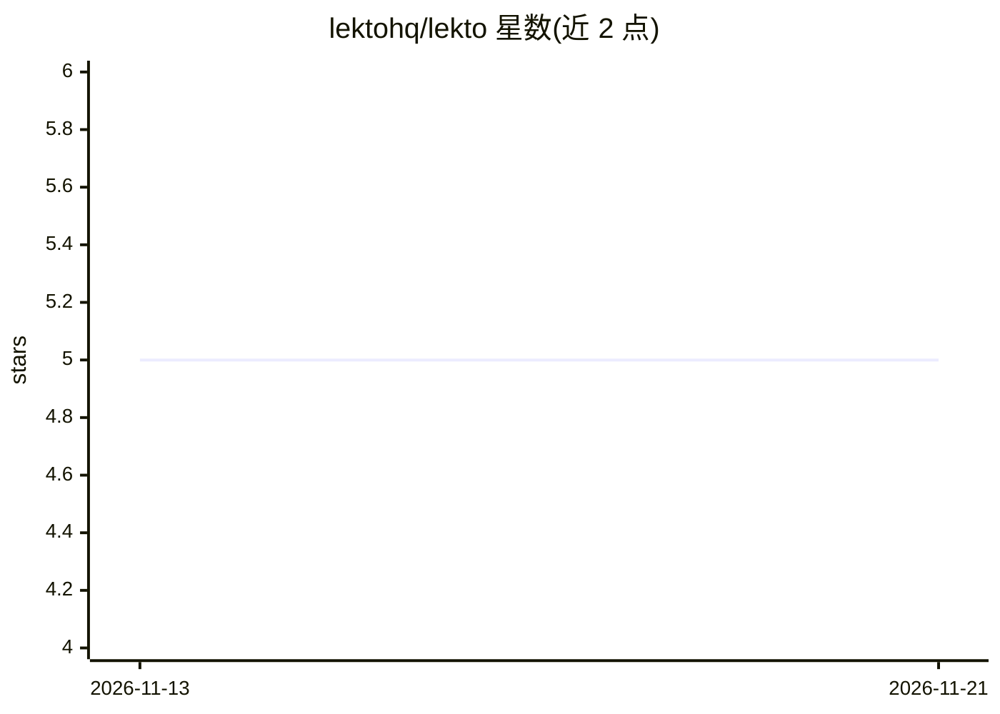

# lektohq/lekto

⭐ 5 · Python · GPL-3.0 · 推送 2026-11-20 · [GitHub](https://github.com/lektohq/lekto) · 个人维护

**自托管文档管理系统：OCR 归档文档并提供可解释检索与 AI 客户端接入**

自托管、无头（headless）的文档管理系统：文档经 OCR（OCRmyPDF/PDF/A）摄入后，由语言模型、分类器与相似文档提出建议，judge 决策并给出绿/黄/红三通道（完成/需确认/需人工介入），每个步骤有日志可复现。支持 IMAP 邮箱附件转文档、基于 Meilisearch 的词语+语义混合检索、按空间划分的权限（TOTP/OpenID 登录）、版本化规则与 webhook/SSE/MCP 集成。通过 docker compose 部署，REST API 为唯一入口。README 声明处于 beta，可能存在破坏性变更，建议仅用于非生产环境。

## 筛选速览

| 维度 | 判定 | 备注 |
|---|---|---|
| AI 角色 | `ai-enhanced` | 去掉 AI 部分产品仍成立 |
| 许可风险 | `viral` | GPL-3.0 |
| 部署形态 | `self-host` | docker 或自建部署 |
| 模型依赖 | local-ok | 支持本地模型 |
| 硬件要求 | — | 无带数字的原话,不猜 |
| 安装摩擦 | `low` | 无编译、无系统依赖或容器化 |
| 成熟度 | `idea` | |

## 能力要点

- 可解释摄入流程：模型/分类器提议，judge 决策，三通道分流，全程日志
- Meilisearch 混合检索（词语+语义），权限范围内生效
- MCP 服务器端点供 Claude 等 AI 客户端接入
- 支持 IMAP 邮箱附件自动归档与 SHA-256 寻址的原始文件不可变存储

## 适用场景

- 家庭实验室（homelab）中自托管管理个人/家庭纸质与电子文档
- 将邮箱附件自动归档为可检索的文档库
- 通过 Claude 等 MCP 客户端检索与管理文档

## 场景标签

`语义搜索` `OCR` `文档问答` `知识库管理` · 领域:知识与检索

## 证据(README 行号)

> L16: **Lekto DMS** is a self-hosted, headless document management system. It reads every document,
> L39: - **Integration.** Signed webhooks, server-sent events and an MCP server at `/api/v1/mcp` for
> L51: `LEKTO_LLM_BASE_URL` and `LEKTO_EMBEDDING_BASE_URL` at Ollama or another OpenAI-compatible

## 星数曲线

2026-11-13 5 → 2026-11-21 5（+0）

---
*卡片 v1 · prompt 1.4 · 生成 2026-11-21 · 置信度 high · 依据 README sha `0b546b3bb683` · [字段定义](../../DATASET.md)*
