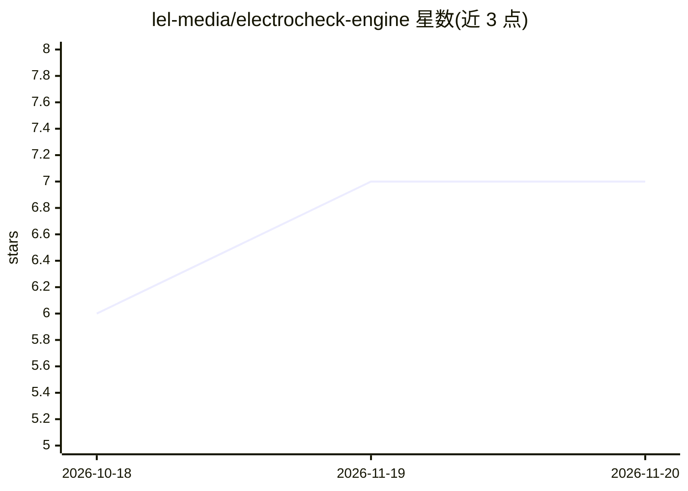

# lel-media/electrocheck-engine

⭐ — · [GitHub]() · 组织维护

**事实核查引擎：对声明输出带来源与置信度的判定**

Electrocheck（法国政治电视实时事实核查项目 Les Électrons Libres）的判定引擎，以单文件 Python HTTP 服务运行，接收从转写文本中抽取的声明，执行 1–3 次 Gemini（带 Google Search）调用，可选配合 Linkup 网络搜索，输出六级判定（vrai/faux 等）、逐条引用来源的解释、置信度与来源分级（官方/主流媒体/其他）。代码层设守门机制：判定标志缺失或证据缺失时强制改为 insuffisant。每次核查写入 JSONL 日志记录推理过程。输入的实时转写与声明抽取不包含在本仓库内。

## 筛选速览

| 维度 | 判定 | 备注 |
|---|---|---|
| AI 角色 | `ai-native` | 本体是模型或模型工具 |
| 许可风险 | `permissive` | — |
| 部署形态 | `library` | 以包/库形式分发 |
| 模型依赖 | — | README 未给出锁定关系 |
| 硬件要求 | — | 无带数字的原话,不猜 |
| 安装摩擦 | `low` | 无编译、无系统依赖或容器化 |
| 成熟度 | — | 结构信号不足 |

## 能力要点

- 输出六级判定、来源分级引用与置信度
- 代码层守门机制：无证据或标志缺失时强制 insuffisant
- 1–3 次 Gemini 调用加可选 Linkup 搜索，两种调用顺序可配置
- 每次核查追加 JSONL 日志，记录各次模型调用与最终决策

## 适用场景

- 对电视转写中抽取的声明自动判定真伪并给出出处
- 构建需要来源分级与无证据降级机制的核查流水线
- 通过 JSONL 日志复核每次判定的推理依据

## 场景标签

 · 领域:事实核查/媒体信息验证

## 证据(README 行号)

> L4: Les Électrons Libres. It takes a claim made on air and decides whether it is true, on which sources, and how sure it
> L24: 2. **The model's answer.** A verdict (`vrai`, `plutot_vrai`, `mixte`, `plutot_faux`, `faux`, `insuffisant`), an
> L31: 3. **The code has the last word.** Any flag that is false or missing turns the verdict into `insuffisant`

## 星数曲线

2026-10-18 6 → 2026-11-20 7（+1）

---
*卡片 v1 · prompt 1.4 · 生成 2026-11-20 · 置信度 high · 依据 README sha `743b34bc76f3` · [字段定义](../../DATASET.md)*
