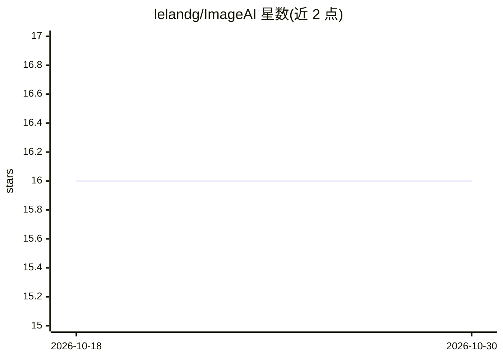

# lelandg/ImageAI

⭐ 16 · Python · 推送 2026-10-23 · [GitHub](https://github.com/lelandg/ImageAI) · 个人维护

**多提供商 AI 图像/视频生成桌面应用与 CLI**

基于 Qt/PySide6 的桌面应用加命令行工具，接入 Google Gemini、OpenAI GPT Image/DALL·E、Stability API 及本地 Stable Diffusion 模型生成图像，并提供文本生成视频流水线（FFmpeg 幻灯片渲染、歌词场景、MIDI 同步卡拉OK）、照片书/漫画排版引擎、Real-ESRGAN 超分与多 LLM 提示词增强（GPT-5/Claude/Gemini/Ollama/LM Studio）。支持 API Key 与 Google Cloud 企业认证，跨 Windows/macOS/Linux。功能面广，含大量仍在演进的条目（Veo 渲染标注 coming soon）。

## 筛选速览

| 维度 | 判定 | 备注 |
|---|---|---|
| AI 角色 | `ai-native` | 本体是模型或模型工具 |
| 许可风险 | `none` | — |
| 部署形态 | `library` | 以包/库形式分发 |
| 模型依赖 | local-ok | 支持本地模型 |
| 硬件要求 | — | 无带数字的原话,不猜 |
| 安装摩擦 | `medium` | 含编译或系统依赖之一 |
| 成熟度 | `idea` | |

## 能力要点

- 接入 Gemini/OpenAI/Stability API 与本地 Stable Diffusion 的多提供商图像生成
- 文本生成视频流水线（版本控制、FFmpeg 渲染、MIDI 同步卡拉OK）
- 多 LLM 提示词增强与提示词问答（GPT-5/Claude/Gemini/Ollama/LM Studio）
- Real-ESRGAN 超分与专业排版引擎（照片书/漫画/出版物）

## 适用场景

- 用一个工具在多个图像生成提供商之间切换出图
- 制作 AI 场景视频、歌词可视化或卡拉OK 视频
- 维护角色一致性的多参考图生成与排版设计

## 场景标签

`图像生成` `视频生成` `提示工程` · 领域:Agent 开发

## 证据(README 行号)

> L15: **ImageAI** is a powerful desktop application and CLI tool for AI image generation, video creation, and professiona
> L194: - **Complete Video Creation Pipeline** - Text to video with AI scene generation

## 星数曲线

2026-10-18 16 → 2026-10-30 16（+0）

---
*卡片 v1 · prompt 1.4 · 生成 2026-10-30 · 置信度 high · 依据 README sha `d77e08ac4a56` · [字段定义](../../DATASET.md)*
