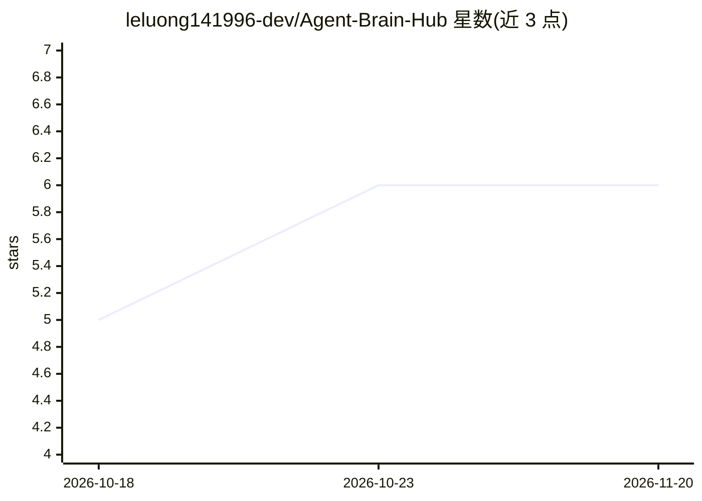

# leluong141996-dev/Agent-Brain-Hub

⭐ — · [GitHub]() · 个人维护

**多智能体共享记忆中枢：治理、审计多 agent 共用的记忆**

为多 agent 系统提供单一共享记忆的服务：每个 agent 通过各自 API key 经 REST/SDK/MCP 读写同一份记忆，按关系级别设置私有/共享/全局作用域、所有者与写策略，冲突由策略裁决并保留历史；读写进入 append-only 审计日志。存储为单个 SQLite 文件，规则与模板模式下无需 LLM，可选接入 LLM 做事实抽取与摘要。含实时可视化 UI、63 场景离线基准与防火墙机制，支持英语/越南语/日语。Node.js ≥ 22 或 Docker 运行。

## 筛选速览

| 维度 | 判定 | 备注 |
|---|---|---|
| AI 角色 | `ai-ecosystem` | LLM/agent 周边工具 |
| 许可风险 | `permissive` | — |
| 部署形态 | `self-host` | docker 或自建部署 |
| 模型依赖 | local-ok | 支持本地模型 |
| 硬件要求 | — | 无带数字的原话,不猜 |
| 安装摩擦 | `low` | 无编译、无系统依赖或容器化 |
| 成熟度 | — | 结构信号不足 |

## 能力要点

- 每 agent 独立 key 与读写权限，append-only 审计日志
- 记忆防火墙截留疑似指令的值，防植入指令传播
- 无 LLM 也可运行（规则+模板），单 SQLite 文件存储
- recall/remember 两个调用即可接入自有模型，MCP 支持 Claude Code/Cursor

## 适用场景

- 多个 agent 协作开发同一仓库时共享已知坑与规范
- 客服与差旅等面向客户 agent 间共享事实同时隔离隐私
- 审计哪个 agent 在何时读取/写入了哪条记忆

## 场景标签

`Agent 记忆` `多智能体` · 领域:Agent 开发

## 证据(README 行号)

> L11: **Governed shared memory for multi-agent systems.** Every agent you run (Claude Code, Cursor, LangGraph nodes, your
> L69: - **Governed by design.** Each relation has a scope (private / shared / global), an owner and a write policy; each 
> L73: - **Light to run.** One SQLite file, no vector or graph database. It works without an LLM (rules and templates, $0 

## 星数曲线

2026-10-18 5 → 2026-11-20 6（+1）

---
*卡片 v1 · prompt 1.4 · 生成 2026-11-20 · 置信度 high · 依据 README sha `f7a7e8e42d20` · [字段定义](../../DATASET.md)*
