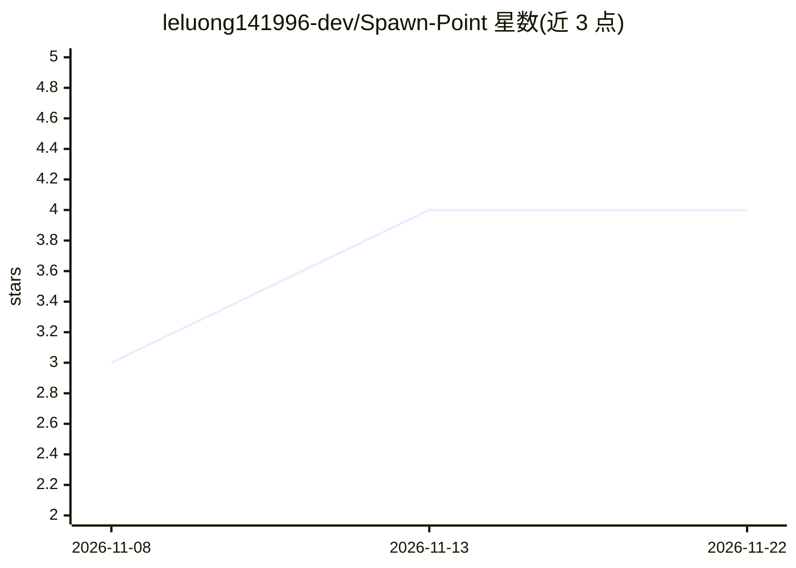

# leluong141996-dev/Spawn-Point

⭐ 4 · Python · MIT · 推送 2026-11-07 · [GitHub](https://github.com/leluong141996-dev/Spawn-Point) · [官网](https://leluong141996-dev.github.io/Spawn-Point/) · 个人维护

**一句话生成可玩 2D 像素游戏，本地运行面向新手与 game jam**

Spawn Point 接收一句自然语言描述（支持英文与越南语），由微调模型 SpawnPoint-Coder-7B 生成 JSON 格式的游戏设计，再由确定性编译器基于手写、测试过的 Godot 4 组件组装出完整游戏项目；像素画、音效与 chiptune 音乐全部由代码生成，无需素材。模型在本地运行（12GB NVIDIA GPU 或 Ollama），无需 API key。产出为真实 Godot 4 工程，可打包为网页游戏并上传 itch.io，也可继续手工开发。

## 筛选速览

| 维度 | 判定 | 备注 |
|---|---|---|
| AI 角色 | `ai-native` | 本体是模型或模型工具 |
| 许可风险 | `permissive` | MIT |
| 部署形态 | `library` | 以包/库形式分发 |
| 模型依赖 | local-ok | 支持本地模型 |
| 硬件要求 | — | 无带数字的原话,不猜 |
| 安装摩擦 | `medium` | 含编译或系统依赖之一 |
| 成熟度 | — | 结构信号不足 |

## 能力要点

- 7B 微调模型生成设计 JSON，编译器与测试过的 Godot 组件构建游戏
- 像素画、背景、特效、音乐与音效全部由代码生成，无外部素材
- CLI 词句修改（spawnpoint tweak）与 web cockpit 右键编辑
- 一条命令打包网页版并上传 itch.io

## 适用场景

- game jam 快速得到可玩原型再手工迭代
- 零美术基础的新手制作完整 2D 游戏
- 将生成的网页游戏分享到 itch.io 或静态托管

## 场景标签

`代码生成` · 领域:编码与开发

## 证据(README 行号)

> L5: **Make a 2D game from one sentence in about 20 seconds. Change it by saying what you want. Share it as a web game.**
> L112: The AI never writes game code. A small fine-tuned model,
> L114: hero, enemy behaviours, theme, goal) as JSON, and a deterministic compiler builds the game from **hand-written,

## 星数曲线

2026-11-08 3 → 2026-11-22 4（+1）

---
*卡片 v1 · prompt 1.4 · 生成 2026-11-21 · 置信度 high · 依据 README sha `bed11e0f0572` · [字段定义](../../DATASET.md)*
