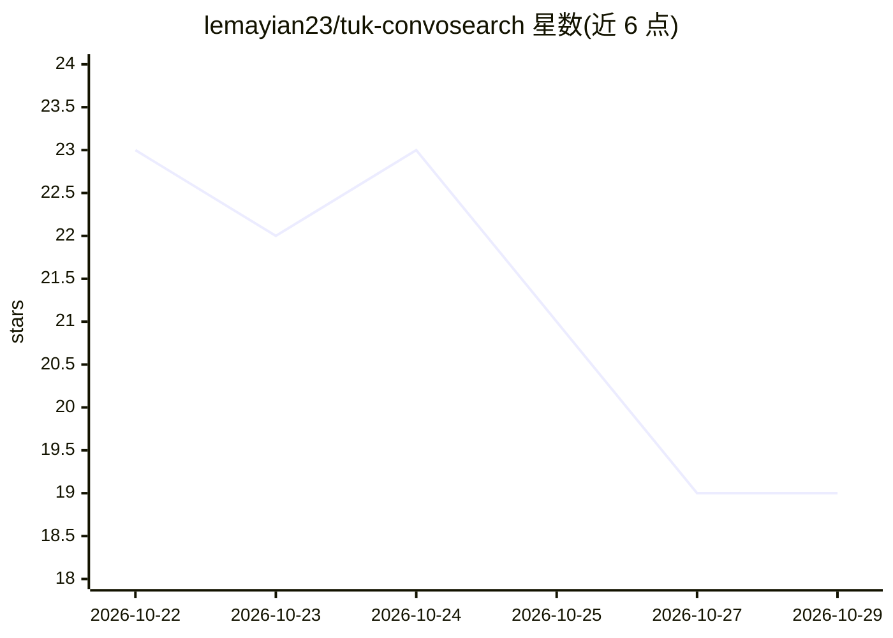

# lemayian23/tuk-convosearch

⭐ 19 · Python · MIT · 推送 2026-10-20 · [GitHub](https://github.com/lemayian23/tuk-convosearch) · [官网](https://lemayian.com) · 个人维护

**面向肯尼亚理工大学学生的本地化 RAG 问答平台**

FastAPI 服务 + React 学生界面 + 管理面板，基于官方 TU-K 文档（PDF/DOCX/TXT/MD）做检索问答，嵌入用 all-MiniLM-L6-v2 存 SQLite 并以 FAISS 检索，LLM 由本地 Ollama 提供，支持 SSE 流式回答、按 IP 限流、SQLite 会话持久化。底层是可组合 agent 与可替换 store 的管道框架，同一套 agent 类通过配置文件组装出第二条 PubMed 癌症文献助手管道（嵌入 S-PubMedBert，LLM 引用核查）。本地开发需 Python 3.10+ 与 Ollama，生产用 Docker（Ollama+FastAPI+Caddy 三容器），130 个单元测试不依赖 LLM 调用。

## 筛选速览

| 维度 | 判定 | 备注 |
|---|---|---|
| AI 角色 | `ai-native` | 本体是模型或模型工具 |
| 许可风险 | `permissive` | MIT |
| 部署形态 | `self-host` | docker 或自建部署 |
| 模型依赖 | local-ok | 支持本地模型 |
| 硬件要求 | `cpu-ok` | |
| 安装摩擦 | `low` | 无编译、无系统依赖或容器化 |
| 成熟度 | — | 结构信号不足 |

## 能力要点

- 同一套 agent/管道类通过配置文件支撑两个领域（TU-K 问答与 PubMed 癌症文献）
- 检索后端、路由、查询扩展、合成器（Ollama/OpenAI/Anthropic）、Critic 均可替换
- SSE 流式回答、管理面板（JWT 鉴权）、按 IP 限流、会话与查询日志存 SQLite
- 130 个无 I/O 单元测试（Ollama 被模拟）与固定题集评测工具

## 适用场景

- 学生在 Web 界面查询学校官方文档相关问题并获得带引用的流式回答
- 管理员上传文档、重建索引、查看查询日志
- 通过新增配置文件扩展新领域（如法律文献）的 RAG 管道
- 在 VPS 上以 Docker 三容器栈部署本地 LLM 问答服务

## 场景标签

`RAG` `文档问答` `科研工具` · 领域:知识与检索

## 证据(README 行号)

> L3: **A production RAG assistant for TU-K students, built from composable agents.**
> L50: - **Source:** Official TU-K documents (PDFs, DOCX, TXT, MD) in `corpus/tuk/`, extracted and chunked at ingestion

## 星数曲线

2026-10-22 23 → 2026-10-29 19（-4）

---
*卡片 v1 · prompt 1.4 · 生成 2026-10-28 · 置信度 mid · 依据 README sha `314db09151ed` · [字段定义](../../DATASET.md)*
