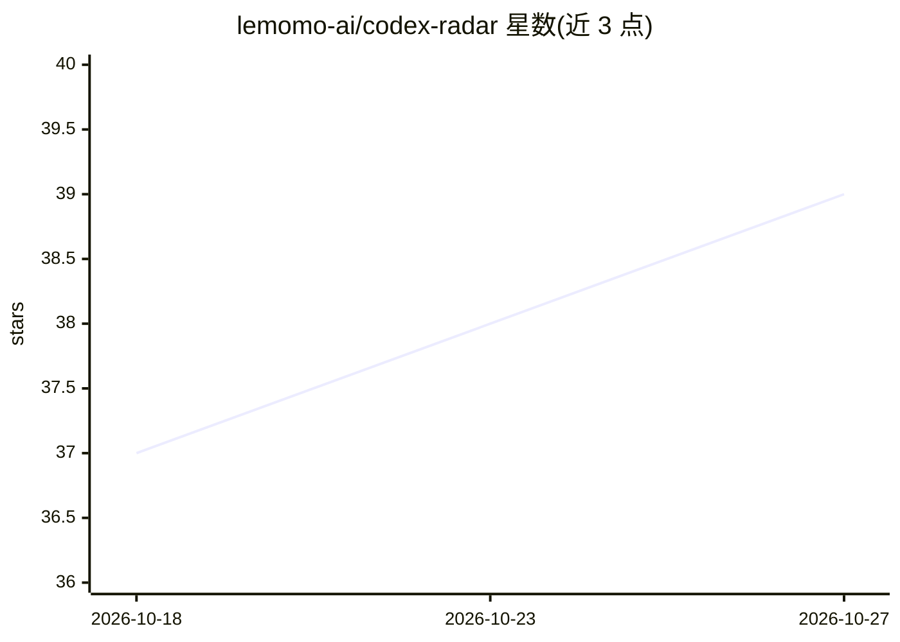

# lemomo-ai/codex-radar

⭐ 39 · NOASSERTION · 推送 2026-09-20 · [GitHub](https://github.com/lemomo-ai/codex-radar) · [官网](https://lemomo-ai.github.io/codex-radar/) · 组织维护 · 中文 README

**Codex CLI 插件：分析本地会话史，生成 9 维协作评分报告**

面向 Codex CLI 用户的插件：读取项目本地会话历史，脚本计算基线与 9 个维度（沟通/工程/成果三类）的分数，由用户当前 Codex 会话撰写诊断与至少 5 条可粘贴的改进 prompt，输出双语自包含 HTML 报告（雷达图、行动计划、证据展开），无需服务器与独立 API key。支持全量/近 30 天/指定日期范围分析，Strict 模式可排除消息与命令摘录等敏感内容。许可证为 CC BY-NC 4.0，另提供商业授权联系渠道。

## 筛选速览

| 维度 | 判定 | 备注 |
|---|---|---|
| AI 角色 | `ai-ecosystem` | LLM/agent 周边工具 |
| 许可风险 | `none` | NOASSERTION |
| 部署形态 | `None` |  |
| 模型依赖 | — | README 未给出锁定关系 |
| 硬件要求 | — | 无带数字的原话,不猜 |
| 安装摩擦 | `low` | 无编译、无系统依赖或容器化 |
| 成熟度 | — | 结构信号不足 |

## 能力要点

- 9 维度（沟通/工程/成果三区）评分与证据引用
- 诊断与改进 prompt 由用户当前 Codex 会话生成，无需独立 API key
- 标准/严格两档隐私模式，脚本无网络调用、无遥测
- 报告为自包含 HTML 文件，可离线打开并跟踪改进

## 适用场景

- 分析自己与 Codex 协作中的瓶颈与低效习惯
- 获取针对当前项目的可粘贴改进 prompt 与工作流
- 对比前后两次报告验证协作行为是否改善

## 场景标签

`模型评测` · 领域:评测与运维

## 证据(README 行号)

> L24: codex plugin marketplace add lemomo-ai/codex-radar
> L40: Radar uses the project you selected, reads its local session history, and generates a report in `~/.codex-radar/rep
> L52: Scores are coaching indicators based on recorded behavior, not a measure of code quality or a comparison against ot

## 星数曲线

2026-10-18 37 → 2026-10-27 39（+2）

---
*卡片 v1 · prompt 1.4 · 生成 2026-10-25 · 置信度 high · 依据 README sha `5ed801db656f` · [字段定义](../../DATASET.md)*
