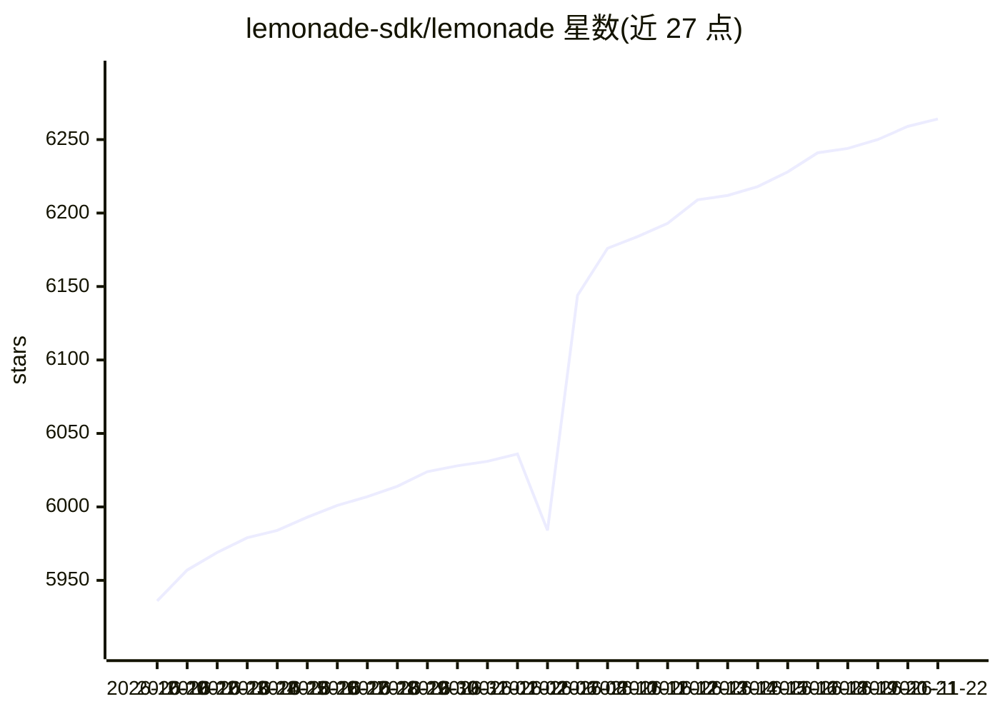

# lemonade-sdk/lemonade

⭐ 6,264 · C++ · Apache-2.0 · 推送 2026-11-21 · [GitHub](https://github.com/lemonade-sdk/lemonade) · [官网](https://lemonade-server.ai/) · 组织维护

**本地 AI 服务器：在自有 GPU/NPU 上运行多模态模型供应用接入**

Lemonade 提供本地 AI 服务器与可嵌入二进制两种形态，支持文本生成、语音识别、TTS、音频/图像/3D 生成等多模态推理。通过 Model Manager 用 lemonade pull 下载 GGUF/FLM/ONNX 格式模型，支持 Hugging Face 与 ModelScope 来源；llamacpp、flm、vllm、onnxruntime 等多种推理引擎按 CPU/GPU/NPU 设备路由，并提供模型别名管理与主备切换。服务器暴露 OpenAI 兼容 API（localhost:13305），可接入 Claude Code、Open WebUI、Dify 等应用；AMD 工程师针对 Ryzen AI/Radeon 做优化，项目由社区维护、AMD 赞助。

## 筛选速览

| 维度 | 判定 | 备注 |
|---|---|---|
| AI 角色 | `ai-ecosystem` | LLM/agent 周边工具 |
| 许可风险 | `permissive` | Apache-2.0 |
| 部署形态 | `desktop` | 安装包/桌面程序 |
| 模型依赖 | local-ok | 支持本地模型 |
| 硬件要求 | — | 无带数字的原话,不猜 |
| 安装摩擦 | `medium` | 含编译或系统依赖之一 |
| 成熟度 | — | 结构信号不足 |

## 能力要点

- 服务器形态兼容 OpenAI/Anthropic/Ollama API，可接入数百个应用
- 支持 GGUF/FLM/ONNX 模型与 CPU/GPU/NPU 多设备推理路由
- 模型别名管理与主备切换（lemonade alias）
- 可嵌入二进制打包进自有应用，无品牌与遥测

## 适用场景

- 在本地 GPU/NPU 上搭建替代云 API 的私有推理服务
- 给 Open WebUI、Claude Code 等应用接入本地模型
- 把本地 AI 能力嵌入自己的桌面/移动应用
- 用 lemonade CLI 命令行下载并运行/对话模型

## 场景标签

`推理引擎` · 领域:训练与推理

## 证据(README 行号)

> L24: Lemonade is the local AI server that gives you the same capabilities as cloud APIs, except 100% free and private. U
> L28: * **Lemonade Server** installs a service you can connect to hundreds of great apps using standard OpenAI, Anthropic

## 星数曲线

2026-10-20 5,936 → 2026-11-22 6,264（+328）

---
*卡片 v1 · prompt 1.4 · 生成 2026-11-22 · 置信度 high · 依据 README sha `938e67032391` · [字段定义](../../DATASET.md)*
