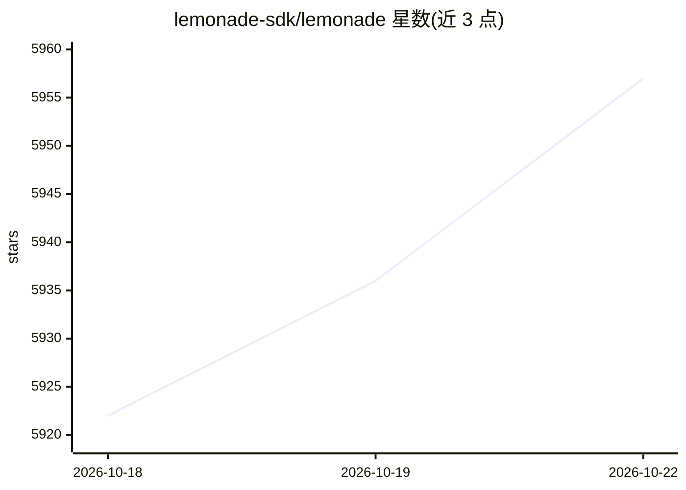

# lemonade-sdk/lemonade

⭐ 5,957 · C++ · Apache-2.0 · 推送 2026-10-21 · [GitHub](https://github.com/lemonade-sdk/lemonade) · [官网](https://lemonade-server.ai/) · 组织维护

**在用户本地 GPU/NPU 上运行多模态 AI 模型的本地 AI 服务器**

Lemonade 提供两种形态：Lemonade Server 作为本地服务，通过标准 OpenAI、Anthropic 和 Ollama API 接入数百个应用；Embeddable Lemonade 是可打包进自有应用的可移植二进制，自动针对用户 PC 优化。支持文本生成、语音转文字、TTS、音频与图像/3D 生成等多种模态，模型格式覆盖 GGUF、FLM、ONNX，后端包含 llamacpp、vllm、NPU（XDNA2）等，适配 CPU/GPU/NPU 及 AMD ROCm、NVIDIA CUDA、Apple Metal 平台。项目由社区构建，含 AMD 工程师参与优化，并由 AMD 赞助。提供 CLI 与 Model Manager 管理模型下载、别名与故障切换。

## 筛选速览

| 维度 | 判定 | 备注 |
|---|---|---|
| AI 角色 | `ai-ecosystem` | LLM/agent 周边工具 |
| 许可风险 | `permissive` | Apache-2.0 |
| 部署形态 | `desktop` | 安装包/桌面程序 |
| 模型依赖 | local-ok | 支持本地模型 |
| 硬件要求 | — | 无带数字的原话,不猜 |
| 安装摩擦 | `medium` | 含编译或系统依赖之一 |
| 成熟度 | `idea` | |

## 能力要点

- Lemonade Server 以 OpenAI/Anthropic/Ollama 标准 API 对接应用
- 支持文本、语音、TTS、音频、图像与 3D 生成多模态
- 多推理后端：llamacpp、vllm、ROCm、CUDA、Metal、XDNA2 NPU 等
- Embeddable Lemonade 可嵌入自有应用并自动优化

## 适用场景

- 在本机 GPU/NPU 上免费私有地运行 LLM 进行聊天与编程
- 把本地模型接入 Claude Code、Dify、Open WebUI 等应用
- 通过 CLI 或 Model Manager 下载并管理 GGUF/ONNX 模型

## 场景标签

`推理引擎` `多模态` · 领域:感知与多模态

## 证据(README 行号)

> L24: Lemonade is the local AI server that gives you the same capabilities as cloud APIs, except 100% free and private. U
> L28: * **Lemonade Server** installs a service you can connect to hundreds of great apps using standard OpenAI, Anthropic

## 星数曲线

2026-10-18 5,922 → 2026-10-22 5,957（+35）

---
*卡片 v1 · prompt 1.4 · 生成 2026-10-20 · 置信度 high · 依据 README sha `7fb38ea69d0e` · [字段定义](../../DATASET.md)*
