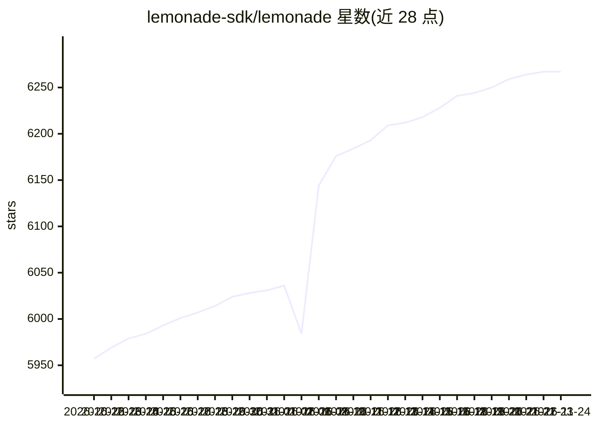

# lemonade-sdk/lemonade

⭐ 6,267 · C++ · Apache-2.0 · 推送 2026-11-22 · [GitHub](https://github.com/lemonade-sdk/lemonade) · [官网](https://lemonade-server.ai/) · 组织维护

**本地 AI 服务器：在 NPU/GPU 上运行并服务多模态模型**

Lemonade 是一个本地 AI 服务器，通过标准 OpenAI、Anthropic 与 Ollama 兼容 API 向数百个应用提供本地运行的模型，覆盖聊天、代码、语音与图像生成；另有可嵌入应用的便携二进制形态。模型管理器支持浏览、下载 GGUF/FLM/ONNX、whisper、stable diffusion 等模型，可从 Hugging Face 或 ModelScope 拉取；支持 llamacpp、FLM、vllm、onnxruntime 等推理引擎与 CPU/GPU/NPU 多后端，提供模型别名与主备切换。安装覆盖 Windows/Linux/macOS/Docker/源码。

## 筛选速览

| 维度 | 判定 | 备注 |
|---|---|---|
| AI 角色 | `ai-ecosystem` | LLM/agent 周边工具 |
| 许可风险 | `permissive` | Apache-2.0 |
| 部署形态 | `desktop` | 安装包/桌面程序 |
| 模型依赖 | local-ok | 支持本地模型 |
| 硬件要求 | — | 无带数字的原话,不猜 |
| 安装摩擦 | `medium` | 含编译或系统依赖之一 |
| 成熟度 | — | 结构信号不足 |

## 能力要点

- 兼容 OpenAI、Anthropic、Ollama API 的本地服务器（localhost:13305）
- 多模态：文本生成、语音识别、TTS、音频/图像/3D 生成
- 支持 GGUF/FLM/ONNX 模型，可从 Hugging Face 或 ModelScope 拉取
- 模型别名管理与主备即时切换；实验性云上负载分流

## 适用场景

- 在本地 NPU/GPU 上运行模型，给 Open WebUI 等应用当后端
- 管理本地模型下载与别名，做主备切换
- 把本地 AI 能力嵌入自己的应用（Embeddable 版）

## 场景标签

`推理引擎` `图像生成` `语音合成` `语音识别` · 领域:内容生成

## 证据(README 行号)

> L24: Lemonade is the local AI server that gives you the same capabilities as cloud APIs, except 100% free and private. U
> L28: * **Lemonade Server** installs a service you can connect to hundreds of great apps using standard OpenAI, Anthropic
> L120: Lemonade supports multiple inference engines for LLM, speech, TTS, and image generation, and each has its own back

## 星数曲线

2026-10-22 5,957 → 2026-11-24 6,267（+310）

---
*卡片 v1 · prompt 1.4 · 生成 2026-11-23 · 置信度 high · 依据 README sha `428faf3be0f3` · [字段定义](../../DATASET.md)*
