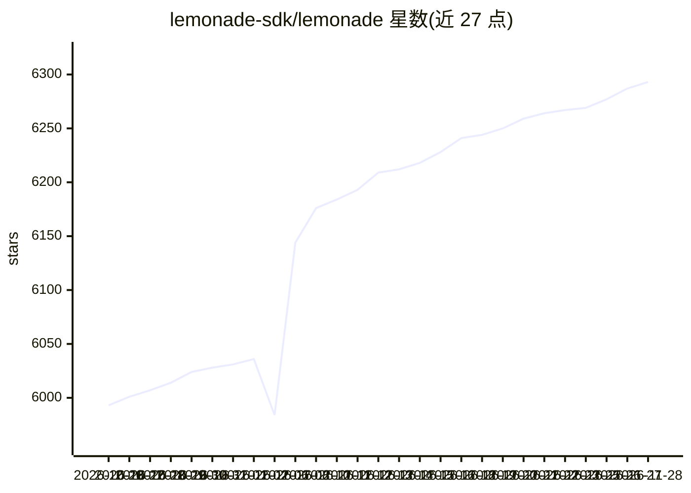

# lemonade-sdk/lemonade

⭐ 6,293 · C++ · Apache-2.0 · 推送 2026-11-27 · [GitHub](https://github.com/lemonade-sdk/lemonade) · [官网](https://lemonade-server.ai/) · 组织维护

**本地 AI 服务器：在 NPU/GPU 上运行 LLM、语音、图像模型**

Lemonade 提供两种形态：Lemonade Server 以 OpenAI、Anthropic、Ollama 兼容 API 供数百款应用接入，Embeddable Lemonade 为可打包进自有应用的便携二进制。通过 Model Manager 下载 GGUF/FLM/ONNX、whisper、stable diffusion 等模型，支持文本生成、语音识别、TTS、音频与图像及 3D 生成，按 CPU/GPU/NPU 设备自动选择推理引擎后端（llamacpp、flm、vllm 等），并提供别名管理与主备切换、云端路由（实验性）。提供 Windows/Linux/macOS/Docker 安装及 iOS/Android 客户端。

## 筛选速览

| 维度 | 判定 | 备注 |
|---|---|---|
| AI 角色 | `ai-ecosystem` | LLM/agent 周边工具 |
| 许可风险 | `permissive` | Apache-2.0 |
| 部署形态 | `desktop` | 安装包/桌面程序 |
| 模型依赖 | local-ok | 支持本地模型 |
| 硬件要求 | — | 无带数字的原话,不猜 |
| 安装摩擦 | `medium` | 含编译或系统依赖之一 |
| 成熟度 | — | 结构信号不足 |

## 能力要点

- Server 与可嵌入二进制两种交付形态
- 支持 OpenAI/Anthropic/Ollama 兼容 API 接入数百款应用
- 覆盖 LLM、语音识别、TTS、音频/图像/3D 生成等多模态
- 多推理引擎后端与模型别名主备切换

## 适用场景

- 在自己的 NPU/GPU 上本地运行聊天、编程与图像生成模型
- 为桌面/移动应用嵌入自动优化的本地 AI 能力
- 用 OpenAI 兼容客户端接入本地服务器替代云端 API 调用
- 混合部署中同时路由本地模型与云端提供商

## 场景标签

`推理引擎` `图像生成` `语音识别` `语音合成` · 领域:内容生成

## 证据(README 行号)

> L24: Lemonade is the local AI server that gives you the same capabilities as cloud APIs, except 100% free and private. U
> L28: * **Lemonade Server** installs a service you can connect to hundreds of great apps using standard OpenAI, Anthropic
> L120: Lemonade supports multiple inference engines for LLM, speech, TTS, and image generation, and each has its own back

## 星数曲线

2026-10-26 5,993 → 2026-11-28 6,293（+300）

---
*卡片 v1 · prompt 1.4 · 生成 2026-11-24 · 置信度 high · 依据 README sha `5eb4d731882b` · [字段定义](../../DATASET.md)*
