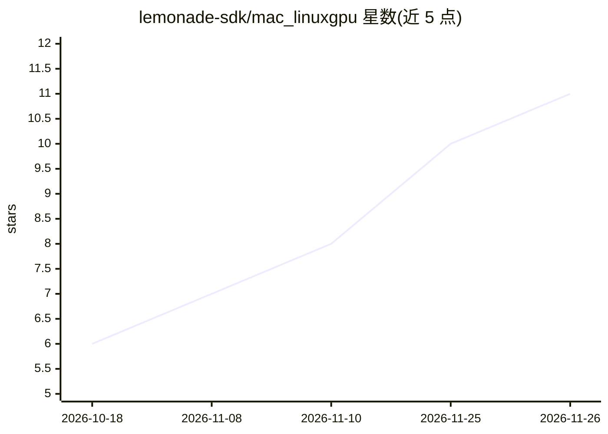

# lemonade-sdk/mac_linuxgpu

⭐ 11 · C · NOASSERTION · 推送 2026-10-11 · [GitHub](https://github.com/lemonade-sdk/mac_linuxgpu) · 组织维护

**让 Linux amdgpu 驱动经雷雳在 Apple Silicon Mac 上运行 AMD GPU**

把上游 Linux 内核的 amdgpu/amdkfd 驱动源码（固定 commit、468 个文件、未修改）编译到 linuxu 用户态内核 API 实现上，封装为 PCIDriverKit 系统扩展，使 Apple Silicon Mac 通过 Thunderbolt 外接的 AMD Radeon GPU 按 Linux 方式完成 IP 发现、固件加载、KFD 计算会话与 HSA 用户队列。附带 HSA 运行时、libdrm、RADV Vulkan（进行中）与监控工具 amdgpu_mtopg。面向需要在 Mac 上运行 Linux/ROCm GPU 软件栈的开发者；当前为 alpha，仅在 Radeon AI PRO R9700 上测试，安装需 Apple 开发者团队的 DriverKit 签名授权。

## 筛选速览

| 维度 | 判定 | 备注 |
|---|---|---|
| AI 角色 | `ai-enhanced` | 去掉 AI 部分产品仍成立 |
| 许可风险 | `permissive` | NOASSERTION |
| 部署形态 | `desktop` | 安装包/桌面程序 |
| 模型依赖 | — | README 未给出锁定关系 |
| 硬件要求 | — | 无带数字的原话,不猜 |
| 安装摩擦 | `low` | 无编译、无系统依赖或容器化 |
| 成熟度 | `idea` | |

## 能力要点

- 未经修改的上游 amdgpu + amdkfd 驱动运行于 DriverKit 扩展内，带源码一致性校验（verify-source）
- KFD 计算会话与 HSA 运行时（libhsa-runtime64.dylib）随驱动安装
- bootstrap 脚本完成内核稀疏检出、补丁与固件哈希校验的一键设置
- RADV Vulkan 路径可构建 llama.cpp 的 Vulkan 后端

## 适用场景

- 在 Apple Silicon Mac 上通过雷雳外接 AMD GPU 运行 HSA/ROCm 计算软件
- 本地运行 LLM 推理引擎并使用外接 Radeon GPU
- 用 amdgpu_mtopg 监控 GPU 负载、频率、温度与显存
- 研究 amdgpu 驱动在非 Linux 平台的移植方式

## 场景标签

 · 领域:系统/驱动与本地推理基础设施

## 证据(README 行号)

> L15: Apple Silicon Macs have Thunderbolt 5 but no AMD GPU driver. **mac_linuxgpu**
> L46: Model: Qwen3.8-27B, 4-bit (MLX). Draft models: MTP 8-bit, DFlash2 8-bit.
> L25: MES-scheduled user queues. The goal is that GPU software written for

## 星数曲线

2026-10-18 6 → 2026-11-26 11（+5）

---
*卡片 v1 · prompt 1.4 · 生成 2026-11-24 · 置信度 high · 依据 README sha `f5c185901732` · [字段定义](../../DATASET.md)*
