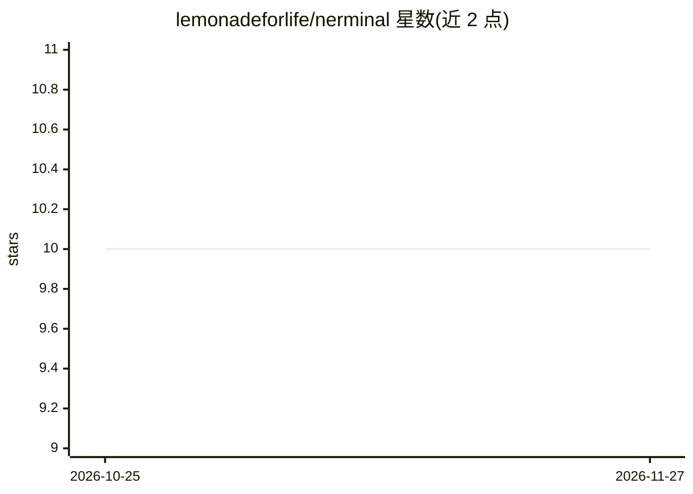

# lemonadeforlife/nerminal

⭐ 10 · Python · MIT · 推送 2026-03-20 · [GitHub](https://github.com/lemonadeforlife/nerminal) · 个人维护

**离线语音助手：唤醒词执行系统命令并本地 LLM 答问**

用 Python 编写的轻量级离线语音助手，监听唤醒词 "hey nerminal" 后执行打开浏览器等系统命令。语音识别用 Vosk 本地引擎，问答走本地量化 GGUF 模型（mpt-7b-instruct），语音回复用 Piper TTS，文本转语音依赖 espeak-ng。完全离线运行，无需联网，支持 Linux 与 Windows。安装通过 uv 管理环境并 git clone 源码运行，需自行下载三个离线模型。项目声明处于早期开发阶段，功能为实验性。

## 筛选速览

| 维度 | 判定 | 备注 |
|---|---|---|
| AI 角色 | `ai-native` | 本体是模型或模型工具 |
| 许可风险 | `permissive` | MIT |
| 部署形态 | `library` | 以包/库形式分发 |
| 模型依赖 | local-ok | 支持本地模型 |
| 硬件要求 | — | 无带数字的原话,不猜 |
| 安装摩擦 | `low` | 无编译、无系统依赖或容器化 |
| 成熟度 | `idea` | |

## 能力要点

- Vosk 离线语音识别与模糊唤醒词检测
- 本地量化 GGUF LLM 对话与回答朗读
- 语音命令打开应用等系统命令执行
- 完全离线运行，无需互联网连接

## 适用场景

- 在本地离线环境下用语音打开应用
- 不联网时用语音向本地 LLM 提问并听取回答
- 在 Linux/Windows 桌面上搭建自定义语音助手

## 场景标签

`语音 Agent` · 领域:对话与助手

## 证据(README 行号)

> L3: Nerminal is a lightweight offline voice assistant written in Python.It listens for the wake phrase "hey nerminal" , 
> L12: - Local quantized LLM integration
> L32: Nerminal will respond using the local LLM and speak the answer.

## 星数曲线

2026-10-25 10 → 2026-11-27 10（+0）

---
*卡片 v1 · prompt 1.4 · 生成 2026-11-19 · 置信度 high · 依据 README sha `7bb5d35cd48e` · [字段定义](../../DATASET.md)*
