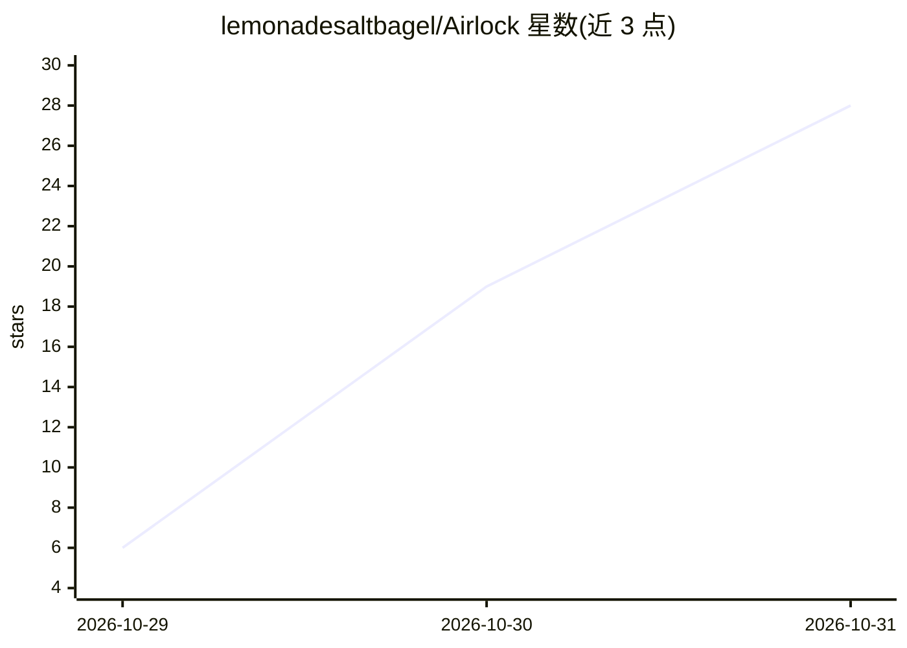

# lemonadesaltbagel/Airlock

⭐ 28 · TypeScript · Apache-2.0 · 推送 2026-10-28 · [GitHub](https://github.com/lemonadesaltbagel/Airlock) · 个人维护

**本地代码 agent：代码不出机，仅以泛化问题咨询云端模型**

在用户本机沙箱（macOS Seatbelt / Linux bubblewrap）内运行本地 agent，读写代码、跑测试并只与本机的 OpenAI 兼容模型服务通信；遇到难点时将问题改写为不含项目标识、字符串与业务细节的最小泛化示例，经用户审批后发送给云端前沿模型咨询。网关在沙箱外持有 API key、转发固定地址并记录加密日志；确定性出口检查拦截项目标识符、字面量、代码片段与声明的核心敏感项。README 标注为 preview 阶段，建议先在测试项目上使用。

## 筛选速览

| 维度 | 判定 | 备注 |
|---|---|---|
| AI 角色 | `ai-ecosystem` | LLM/agent 周边工具 |
| 许可风险 | `permissive` | Apache-2.0 |
| 部署形态 | `library` | 以包/库形式分发 |
| 模型依赖 | — | README 未给出锁定关系 |
| 硬件要求 | — | 无带数字的原话,不猜 |
| 安装摩擦 | `low` | 无编译、无系统依赖或容器化 |
| 成熟度 | `idea` | |

## 能力要点

- 本地 agent 执行工作，云端模型仅以改写后的泛化问题被咨询
- OS 级沙箱限制网络出口与文件访问（Seatbelt/bubblewrap）
- 确定性出口门禁：含项目标识/字面量/敏感项的消息不发送
- 加密防篡改的出站日志与逐模型数据政策查询

## 适用场景

- 在私有代码库上开发而不把源码发给云端模型
- 卡在技术难题时以匿名化最小示例征求前沿模型意见
- 审计每次外发内容与沙箱拦截记录

## 场景标签

`编码 Agent` · 领域:编码与开发

## 证据(README 行号)

> L3: **A local coding agent that keeps your project private and asks frontier models for help without showing them your c
> L18: - **The local agent does the work.** It reads and edits your code, runs your tests and talks only to a model server
> L34: Requires macOS or Linux, Node.js ≥ 22.21, and, for the default profile, an OpenAI-compatible local model server suc

## 星数曲线

2026-10-29 6 → 2026-10-31 28（+22）

---
*卡片 v1 · prompt 1.4 · 生成 2026-10-30 · 置信度 high · 依据 README sha `e1e6b18436a6` · [字段定义](../../DATASET.md)*
