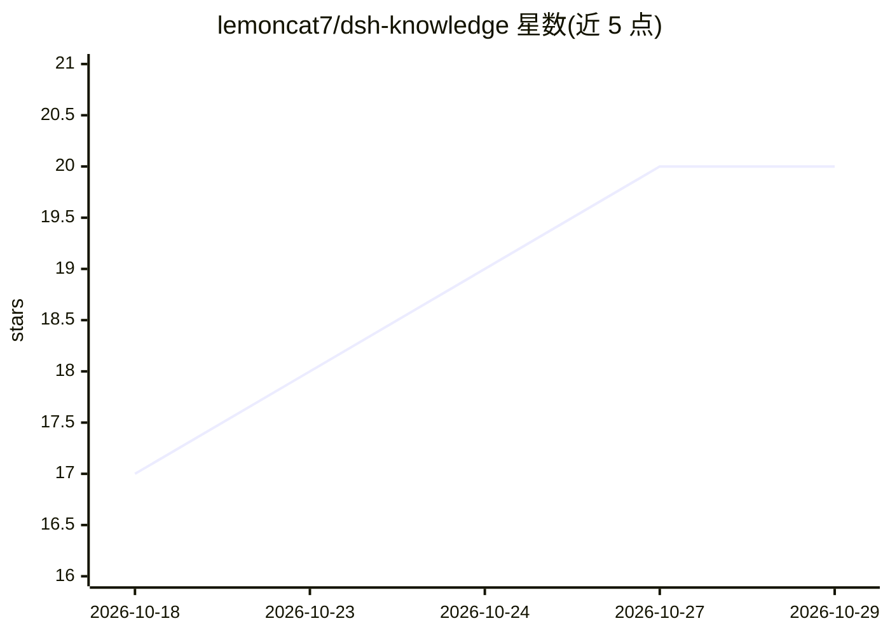

# lemoncat7/dsh-knowledge

⭐ 20 · JavaScript · MIT · 推送 2026-10-28 · [GitHub](https://github.com/lemoncat7/dsh-knowledge) · 个人维护 · 中文 README

**DeepSeek Harness 的知识库、笔记与工作日报插件**

面向 DeepSeek Harness（适配 0.2.1-rc.2）的插件，不修改 DSH Agent Loop：提供知识库与文档分组、全文检索、项目/会话挂载、按权限召回与回写；回答完成后后台提取知识并支持审核、版本历史与冲突保护；独立笔记文档支持 @ 引用；内置工作日报可定时整理与导出。存储用本地 SQLite 或认证的中央知识服务，多客户端可共享。安装方式为 dsh plugin 命令，需 Node.js ^22.19.0 或 >=24.0.0。

## 筛选速览

| 维度 | 判定 | 备注 |
|---|---|---|
| AI 角色 | `ai-ecosystem` | LLM/agent 周边工具 |
| 许可风险 | `permissive` | MIT |
| 部署形态 | `None` |  |
| 模型依赖 | locked-api |  |
| 硬件要求 | — | 无带数字的原话,不猜 |
| 安装摩擦 | `low` | 无编译、无系统依赖或容器化 |
| 成熟度 | `idea` | |

## 能力要点

- 知识库挂载、全文检索与按权限召回/回写
- 回答完成后后台提取知识，含审核、版本历史与冲突保护
- 笔记 @ 引用与工作日报定时整理（默认每日 23:30）
- 本地 SQLite 或认证中央知识服务，多客户端共享

## 适用场景

- 为 DSH Agent 挂载项目知识库并控制召回范围
- 团队通过中央知识服务共享知识库
- 记录与引用工作笔记，自动生成工作日报

## 场景标签

`知识库管理` · 领域:知识与检索

## 证据(README 行号)

> L3: 面向 DeepSeek Harness 的知识库、笔记与工作日报插件。支持本地使用和远程中央知识库，不修改 DSH Agent Loop。
> L9: - 知识库与文档分组、全文检索、项目和会话挂载，按权限召回与回写。

## 星数曲线

2026-10-18 17 → 2026-10-29 20（+3）

---
*卡片 v1 · prompt 1.4 · 生成 2026-10-28 · 置信度 high · 依据 README sha `0e434ea5efa6` · [字段定义](../../DATASET.md)*
