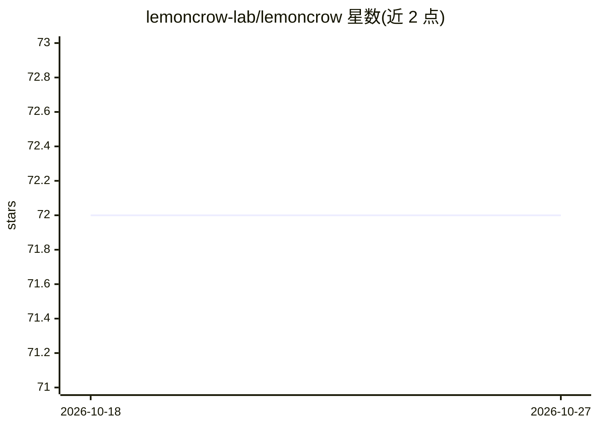

# lemoncrow-lab/lemoncrow

⭐ 72 · Python · NOASSERTION · 推送 2026-10-19 · [GitHub](https://github.com/lemoncrow-lab/lemoncrow) · [官网](https://lemoncrow.com) · 组织维护

**给编码 agent 加本地代码智能运行时与人工评审工具**

面向已在使用 Claude Code、Codex、OpenCode、Cursor 的开发者：Runtime Lite 作为本地插件层，为 agent 提供仓库索引、code_search/read/edit/bash 等本地工具与词法检索，不改变宿主 agent 的模型与配置；Hosted/Enterprise Runtime 提供更深的私有语义检索。另一产品 Review 以本地 Reader 冻结变更、按内容（而非行号）保存人工评审状态，跨修订追踪已评/新改内容。Local Lite 明确不含 embeddings、向量检索与常驻服务；跨工作区上下文尚不可用。

## 筛选速览

| 维度 | 判定 | 备注 |
|---|---|---|
| AI 角色 | `ai-ecosystem` | LLM/agent 周边工具 |
| 许可风险 | `none` | NOASSERTION |
| 部署形态 | `None` |  |
| 模型依赖 | — | README 未给出锁定关系 |
| 硬件要求 | — | 无带数字的原话,不猜 |
| 安装摩擦 | `low` | 无编译、无系统依赖或容器化 |
| 成熟度 | — | 结构信号不足 |

## 能力要点

- 一条 curl 安装命令，`lc with` 临时为 Claude Code/Codex/OpenCode 注入本地工具插件
- Review 将人工评审标记绑定到内容，作者/agent 修订后自动区分已评与新增改动
- SWE-bench Verified 固定跑分：成本低 29.5%、耗时少 23.7%（方法论见 BENCHMARKS.md）
- Local Lite 无常驻守护进程、无监听端口、不上传仓库源码

## 适用场景

- 让现有编码 agent 获得本地仓库检索与编辑工具而不换掉 agent
- 对 agent 产出的变更做增量人工评审并跨修订保留评审状态
- 需要更深语义检索时按需切换 Hosted/Enterprise Runtime

## 场景标签

`Agent 框架` · 领域:Agent 开发

## 证据(README 行号)

> L5: Runtime gives Claude Code, Codex, OpenCode, and Cursor useful local repository
> L75: Runtime Lite is the open-source local Runtime for Claude Code, Codex, OpenCode,
> L203: `lc with` resolves the current Git worktree, prepares the incremental Lite index, and launches your normal coding 

## 星数曲线

2026-10-18 72 → 2026-10-27 72（+0）

---
*卡片 v1 · prompt 1.4 · 生成 2026-10-24 · 置信度 high · 依据 README sha `609a60bac506` · [字段定义](../../DATASET.md)*
