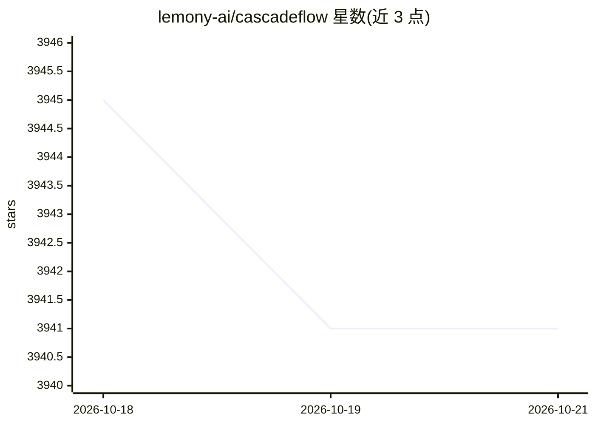

# lemony-ai/cascadeflow

⭐ 3,941 · Python · MIT · 推送 2026-09-25 · [GitHub](https://github.com/lemony-ai/cascadeflow) · [官网](https://cascadeflow.ai) · 组织维护

**面向 AI agent 的进程内模型级联运行时：优化成本/时延/质量/预算**

以 Python/TypeScript 库形式提供的 agent 运行时优化层：通过投机执行小模型、质量校验失败时升级到大模型的级联机制，在 agent 执行循环内做模型选择、按工具调用预算门控，并支持 allow/switch_model/deny_tool/stop 四种运行时动作与逐步决策追踪。声明统一 API 接入 17+ 提供商（OpenAI/Anthropic/Groq/Ollama/vLLM 等），兼容 LangChain、OpenAI Agents SDK、CrewAI、PydanticAI、Google ADK、n8n、Vercel AI SDK 等框架，另提供 n8n 社区节点与 Drop-In 网关模式。可选 ML 语义质量校验包（FastEmbed/BGE 嵌入）。

## 筛选速览

| 维度 | 判定 | 备注 |
|---|---|---|
| AI 角色 | `ai-ecosystem` | LLM/agent 周边工具 |
| 许可风险 | `permissive` | MIT |
| 部署形态 | `library` | 以包/库形式分发 |
| 模型依赖 | local-ok | 支持本地模型 |
| 硬件要求 | — | 无带数字的原话,不猜 |
| 安装摩擦 | `low` | 无编译、无系统依赖或容器化 |
| 成熟度 | — | 结构信号不足 |

## 能力要点

- 投机执行+质量校验的模型级联，失败时升级旗舰模型
- 运行时四动作执行（allow/switch_model/deny_tool/stop）与逐步决策审计
- 进程内运行，声明 sub-5ms 开销；三层集成（observe/budget/policy）
- Python/TypeScript 双语言，n8n 社区节点与 Drop-In 网关两种接入方式

## 适用场景

- 已有 agent 应用降低 LLM 调用成本同时守住质量阈值
- 在工具调用与多步循环中注入预算与合规策略
- 本地模型处理多数请求、复杂查询自动升级云端模型

## 场景标签

`模型网关` · 领域:Agent 开发

## 证据(README 行号)

> L24: **The in-process intelligence layer for AI agents.** Optimize cost, latency, quality, budget, compliance, and energ
> L26: cascadeflow works where external proxies can't: per-step model decisions based on agent state, per-tool-call budget
> L65: - **Framework & Provider Neutral.** Works with LangChain, OpenAI Agents SDK, CrewAI, PydanticAI, Google ADK, Vercel

## 星数曲线

2026-10-18 3,945 → 2026-10-21 3,941（-4）

---
*卡片 v1 · prompt 1.4 · 生成 2026-10-20 · 置信度 high · 依据 README sha `272b38084986` · [字段定义](../../DATASET.md)*
