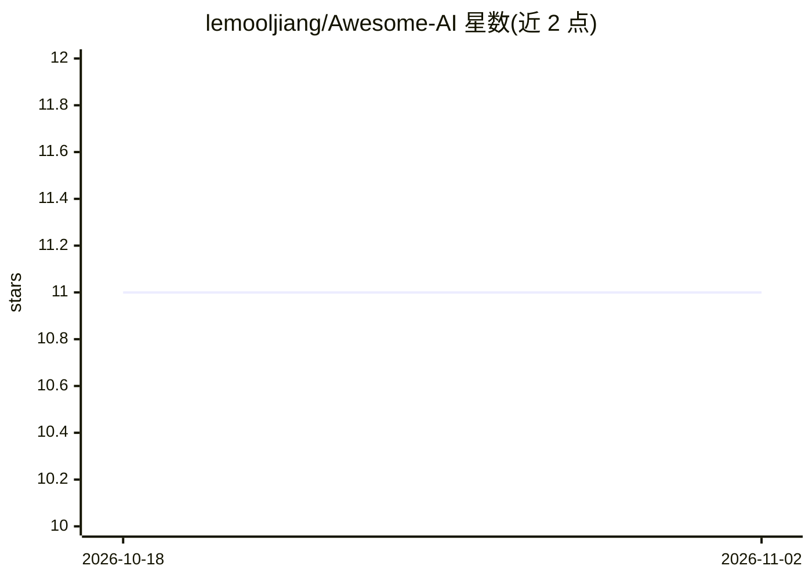

# lemooljiang/Awesome-AI

⭐ 11 · 推送 2026-08-08 · [GitHub](https://github.com/lemooljiang/Awesome-AI) · 个人维护 · 中文 README

**中文 AI 工具与项目分类清单：覆盖助手、Agent、绘图、视频等**

个人维护的中文 AI 资源目录，按 30 余个类别收录数千条链接式条目：AI 助手、Agent 框架、智能体平台、大语言模型、MCP/Skills、绘图修图、设计、编程、前端开发、虚拟角色与数字人、视频剪辑动画、音频、三维生成及机器学习资料等。每条目为一行名称加简介的链接，覆盖国内外产品与开源项目，包含中国厂商产品（字节、阿里、百度、讯飞等）。不提供代码或安装方式，仅作浏览与查找用途。

## 筛选速览

| 维度 | 判定 | 备注 |
|---|---|---|
| AI 角色 | `ai-knowledge` | 知识聚合/清单类 |
| 许可风险 | `none` | — |
| 部署形态 | `None` |  |
| 模型依赖 | — | README 未给出锁定关系 |
| 硬件要求 | — | 无带数字的原话,不猜 |
| 安装摩擦 | `low` | 无编译、无系统依赖或容器化 |
| 成熟度 | — | 结构信号不足 |

## 能力要点

- 按 30+ 类别组织的链接式条目目录
- 覆盖 AI 助手、Agent、LLM、数字人、视频音频等多领域
- 收录较多中国产品与中文资源（扣子、百炼、文心、魔搭等）

## 适用场景

- 查找某类 AI 工具或服务的候选清单
- 了解中文圈常用的 AI 产品和开源项目
- 发现绘图、视频、数字人等垂直方向的工具

## 场景标签

`精选清单` · 领域:学习与行业

## 证据(README 行号)

> L1: # Awesome AI
> L5: ## AI助手
> L80: ## Agent
> L349: ## 绘图

## 星数曲线

2026-10-18 11 → 2026-11-02 11（+0）

---
*卡片 v1 · prompt 1.4 · 生成 2026-11-02 · 置信度 high · 依据 README sha `991a2d344ac4` · [字段定义](../../DATASET.md)*
