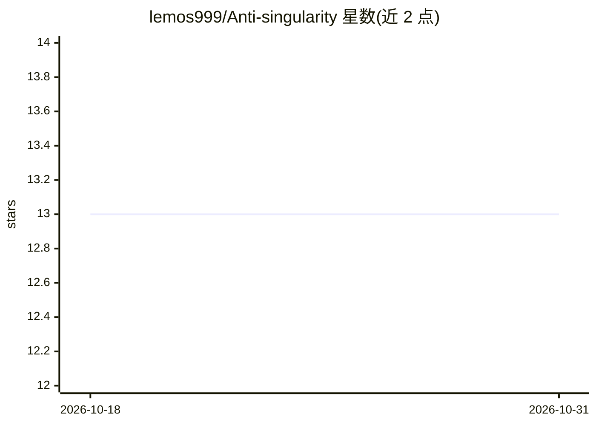

# lemos999/Anti-singularity

⭐ 13 · HTML · 推送 2026-04-23 · [GitHub](https://github.com/lemos999/Anti-singularity) · 个人维护

**自动点击 Cursor/Antigravity 等 AI 编程工具 Accept 按钮的 IDE 扩展**

面向 Cursor、Antigravity、VS Code 的 IDE 扩展：当 AI agent 请求文件修改、终端命令执行或重试确认时，自动代替用户点击 Accept/Retry。支持后台模式，可监视全部打开标签页并以约 0.5~1 秒间隔自动处理，实现多标签并发。内置危险命令（如 rm -rf /、format c:）自动拦截，并允许自定义屏蔽列表。运行依赖开启 CDP（Chrome DevTools 协议），需以管理员权限运行 PowerShell 脚本或带 --remote-debugging-port 参数启动 IDE。自称完全免费。

## 筛选速览

| 维度 | 判定 | 备注 |
|---|---|---|
| AI 角色 | `ai-ecosystem` | LLM/agent 周边工具 |
| 许可风险 | `none` | — |
| 部署形态 | `None` |  |
| 模型依赖 | — | README 未给出锁定关系 |
| 硬件要求 | — | 无带数字的原话,不猜 |
| 安装摩擦 | `low` | 无编译、无系统依赖或容器化 |
| 成熟度 | — | 结构信号不足 |

## 能力要点

- 自动批准 AI agent 的文件修改、终端命令与重试请求
- 后台模式监视全部标签页，支持多 AI 并发
- 危险命令自动拦截并支持自定义屏蔽列表
- 状态栏实时显示 ON/OFF 与后台模式状态

## 适用场景

- AI agent 长时间工作时无人值守自动处理确认弹窗
- 同时运行多个 AI agent 标签页时统一自动批准
- 自动批准同时拦截 rm -rf 等危险命令

## 场景标签

 · 领域:开发工具/AI 编程辅助

## 证据(README 行号)

> L5: **AI가 "이거 해도 돼?" 물어볼 때, 자동으로 "응 해!" 눌러주는 확장이야.**
> L180: A: Cursor, Antigravity, VS Code 다 돼.

## 星数曲线

2026-10-18 13 → 2026-10-31 13（+0）

---
*卡片 v1 · prompt 1.4 · 生成 2026-10-31 · 置信度 high · 依据 README sha `48668e6451f3` · [字段定义](../../DATASET.md)*
