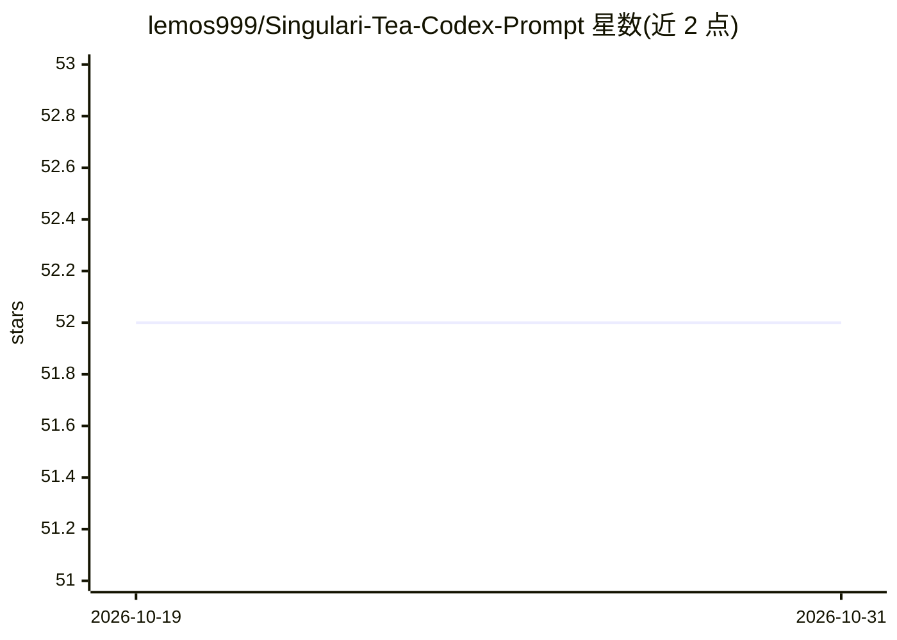

# lemos999/Singulari-Tea-Codex-Prompt

⭐ 52 · Apache-2.0 · 推送 2026-10-18 · [GitHub](https://github.com/lemos999/Singulari-Tea-Codex-Prompt) · 个人维护 · 中文 README

**ChatGPT 项目用对话式叙事世界模拟器提示词包**

面向 ChatGPT 项目功能分发的内容包：将 ProjectInstructions.md 粘贴到项目指令、上传 4 个 Markdown 源文件后，用户选择世界与主角，通过对话和自由行动推进叙事。机制包括基于代码工具的成败判定（反映能力、身体状态、环境）、GenUI 场景界面（按钮、自由输入、照片）、8 回合自动保存与 ZIP 累积存档、跨会话恢复。GPTs 版本为 v6，GEM 版本为 v5；.cc 功能与旧图像模式暂时排除。指南与界面为韩语，运行源文件为英语。

## 筛选速览

| 维度 | 判定 | 备注 |
|---|---|---|
| AI 角色 | `ai-native` | 本体是模型或模型工具 |
| 许可风险 | `permissive` | Apache-2.0 |
| 部署形态 | `None` |  |
| 模型依赖 | — | README 未给出锁定关系 |
| 硬件要求 | — | 无带数字的原话,不猜 |
| 安装摩擦 | `low` | 无编译、无系统依赖或容器化 |
| 成熟度 | — | 结构信号不足 |

## 能力要点

- 对话与自由行动驱动的叙事模拟，含目标/线索/岔路判定机制
- GenUI：场景化按钮、自由输入、Codex 与照片检索
- 8 回合自动保存 + ZIP 累积存档与新会话恢复
- 可选叙事下限 5000/8000/12000/15000 字的输出量控制

## 适用场景

- 在 ChatGPT 项目里玩原作世界或自创世界的人生叙事模拟
- 跨多个对话会话保存并恢复模拟进度
- 在叙事岔路上以概率与代价信息做决策

## 场景标签

`提示工程` · 领域:Agent 开发

## 证据(README 行号)

> L7: This repository distributes the official **World Simulator v6 ChatGPT project package**, based on the GPT edition. C
> L19: 3. 프로젝트 설정의 **지침**에 ProjectInstructions.md의 **내용 전체**를 붙여 넣고 저장합니다.
> L20: 4. 프로젝트의 **소스 → 소스 추가**에서 아래 Markdown 파일 **4개**를 모두 업로드합니다.

## 星数曲线

2026-10-19 52 → 2026-10-31 52（+0）

---
*卡片 v1 · prompt 1.4 · 生成 2026-10-24 · 置信度 high · 依据 README sha `97f5dcf79801` · [字段定义](../../DATASET.md)*
