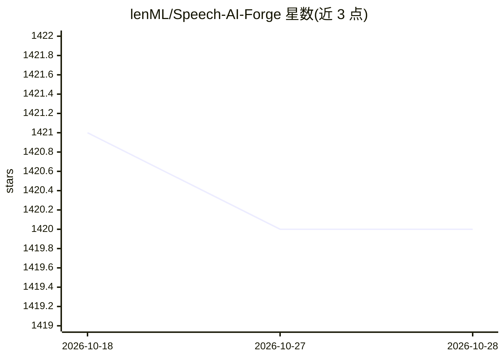

# lenML/Speech-AI-Forge

⭐ 1,420 · Python · AGPL-3.0 · 推送 2026-05-21 · [GitHub](https://github.com/lenML/Speech-AI-Forge) · 个人维护 · 中文 README

**围绕 TTS 模型的语音合成/识别项目：API Server + Gradio WebUI**

围绕多种 TTS 生成模型构建的语音合成项目，提供 API Server（launch.py）与基于 Gradio 的 WebUI（webui.py）。TTS 侧支持 ChatTTS、CosyVoice、FishSpeech、GPT-SoVITS、F5-TTS、Index-TTS、Qwen3-TTS、MiniMax Cloud TTS 等十余种模型，含音色管理、SSML/Podcast 生成、长文本推理与音频后处理；另提供 Whisper/SenseVoice 的 ASR 与文稿匹配。模型可从 HuggingFace 或 ModelScope 下载，支持自动下载。部署方式含 Windows 整合包、Colab、本地 Python 与 Docker。

## 筛选速览

| 维度 | 判定 | 备注 |
|---|---|---|
| AI 角色 | `ai-native` | 本体是模型或模型工具 |
| 许可风险 | `viral` | AGPL-3.0 |
| 部署形态 | `None` |  |
| 模型依赖 | — | README 未给出锁定关系 |
| 硬件要求 | — | 无带数字的原话,不猜 |
| 安装摩擦 | `low` | 无编译、无系统依赖或容器化 |
| 成熟度 | — | 结构信号不足 |

## 能力要点

- 十余种 TTS 模型推理支持（ChatTTS/CosyVoice/FishSpeech/GPT-SoVITS/Qwen3-TTS 等）
- Whisper/SenseVoice ASR 与 Force Alignment 文稿匹配
- 音色构建、抽卡、融合与音色 Hub 管理
- SSML 编辑器与多角色 Podcast 长文本合成
- 模型支持 HuggingFace/ModelScope 双源下载与自动下载

## 适用场景

- 搭建本地 TTS/ASR API 服务供其他应用调用
- 通过 WebUI 用多种模型合成语音并管理音色
- 从字幕或剧本生成多角色播客音频

## 场景标签

`语音合成` `语音识别` · 领域:内容生成

## 证据(README 行号)

> L6: Speech-AI-Forge 是一个围绕 TTS 生成模型开发的项目，实现了 API Server 和 基于 Gradio 的 WebUI。
> L67:  - **多模型支持 (Multi-model Support)**: 支持多种 TTS 模型推理，包括 `ChatTTS` / `CosyVoice` / `FishSpeech` / `GPT-SoVITS` / `F5-TT
> L87:  - **ASR**: 使用 Whisper/SenseVoice 等模型进行高质量的语音转文本（ASR）

## 星数曲线

2026-10-18 1,421 → 2026-10-28 1,420（-1）

---
*卡片 v1 · prompt 1.4 · 生成 2026-10-21 · 置信度 high · 依据 README sha `8ea799c70591` · [字段定义](../../DATASET.md)*
