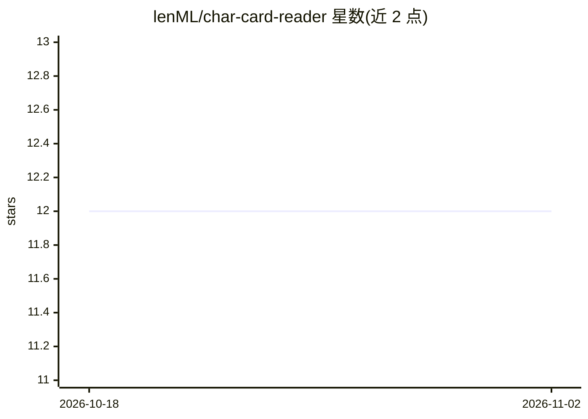

# lenML/char-card-reader

⭐ 12 · TypeScript · AGPL-3.0 · 推送 2025-12-13 · [GitHub](https://github.com/lenML/char-card-reader) · [官网](https://lenml.github.io/char-card-reader/) · 个人维护

**无第三方依赖的 SillyTavern 角色卡读取库**

轻量级 JavaScript/TypeScript 库，从 PNG、JPEG、WEBP 图片及 JSON 数据中读取 SillyTavern 角色卡元数据，支持 v1/v2/v3 三种规范间的相互转换，并可解析 CharacterBook（Lorebook）条目。零外部依赖，同时支持 Node.js 与浏览器环境（含 esm.run CDN 引入）。以 npm 包 @lenml/char-card-reader 分发，AGPL-3.0 许可，面向接入角色卡生态的开发者。

## 筛选速览

| 维度 | 判定 | 备注 |
|---|---|---|
| AI 角色 | `ai-ecosystem` | LLM/agent 周边工具 |
| 许可风险 | `viral` | AGPL-3.0 |
| 部署形态 | `library` | 以包/库形式分发 |
| 模型依赖 | — | README 未给出锁定关系 |
| 硬件要求 | — | 无带数字的原话,不猜 |
| 安装摩擦 | `low` | 无编译、无系统依赖或容器化 |
| 成熟度 | — | 结构信号不足 |

## 能力要点

- 支持角色卡规范 v1、v2、v3 及相互转换
- 从 PNG/JPEG/WEBP 图片提取元数据
- 零外部依赖，Node.js 与浏览器环境均可运行
- 提供 CharacterBook（Lorebook）解析与条目扫描

## 适用场景

- 为角色扮演应用解析 SillyTavern 角色卡文件
- 在不同规范版本的角色卡之间做格式转换
- 从角色卡中读取 Lorebook 并扫描条目

## 场景标签

 · 领域:LLM 角色扮演/数据格式

## 证据(README 行号)

> L6: A lightweight library for reading SillyTavern character card metadata from image files (PNG, JPEG, WEBP) and JSON wi
> L10: - Supports character card specifications v1, v2, and v3

## 星数曲线

2026-10-18 12 → 2026-11-02 12（+0）

---
*卡片 v1 · prompt 1.4 · 生成 2026-11-01 · 置信度 high · 依据 README sha `ff2eb8b8536c` · [字段定义](../../DATASET.md)*
