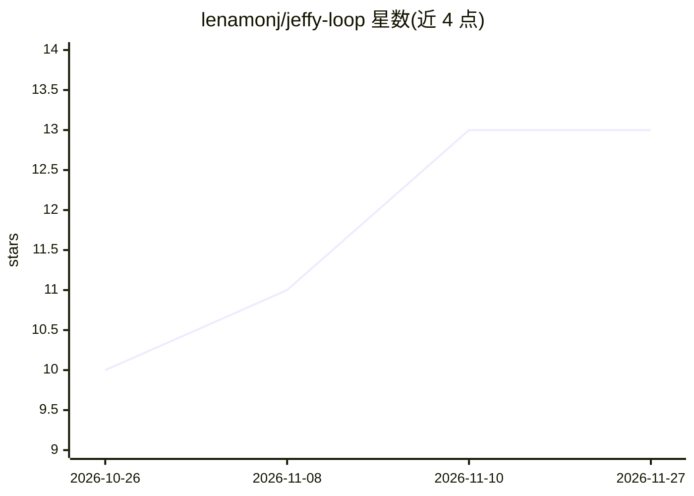

# lenamonj/jeffy-loop

⭐ 13 · Shell · MIT · 推送 2026-11-26 · [GitHub](https://github.com/lenamonj/jeffy-loop) · 个人维护

**基于 Claude Code 的仓库找 bug、修复并验证的自动循环**

围绕 Claude Code 构建的验证 harness：在会话中输入 /jeffy 启动一次运行，审计代码库、修复发现的问题、用可运行的检查验证每个修复并本地提交，直到一次全新审计通过。完成标准为三重门：新审计无 High/Medium 发现、一个未参与运行的对抗性子代理复核签字、测试通过重跑。循环被规则约束为永不 push，修复破坏测试时回退。提供 pip/uv/源码三种安装方式，安装为 Claude Code skill 与一个 Stop hook。

## 筛选速览

| 维度 | 判定 | 备注 |
|---|---|---|
| AI 角色 | `ai-ecosystem` | LLM/agent 周边工具 |
| 许可风险 | `permissive` | MIT |
| 部署形态 | `library` | 以包/库形式分发 |
| 模型依赖 | locked-api |  |
| 硬件要求 | — | 无带数字的原话,不猜 |
| 安装摩擦 | `medium` | 含编译或系统依赖之一 |
| 成熟度 | — | 结构信号不足 |

## 能力要点

- 三重完成门：新审计、对抗性评估员签字、测试重跑通过
- 修复需附可运行的证明检查，破坏测试即回退
- 规则约束不 push，操作限定在会话权限内，/cancel-jeffy 可随时终止
- 公开 132 个第三方项目的运行记录，含失败案例

## 适用场景

- 在自己的仓库持续找 bug 并获得经验证的本地修复提交
- 为开源项目准备可提交上游的缺陷修复
- 对代码库做一轮聚焦 High 级别问题的快速审计

## 场景标签

`代码审查` `编码 Agent` `代码生成` · 领域:编码与开发

## 证据(README 行号)

> L13: The model writes the patch. The harness around it decides whether that patch can be trusted. Jeffy Loop is a verifi
> L15: The harness is deliberately hard to fool. If a fix breaks your tests, the loop is told to revert it. The loop is to

## 星数曲线

2026-10-26 10 → 2026-11-27 13（+3）

---
*卡片 v1 · prompt 1.4 · 生成 2026-11-18 · 置信度 high · 依据 README sha `f3c8e15fa897` · [字段定义](../../DATASET.md)*
