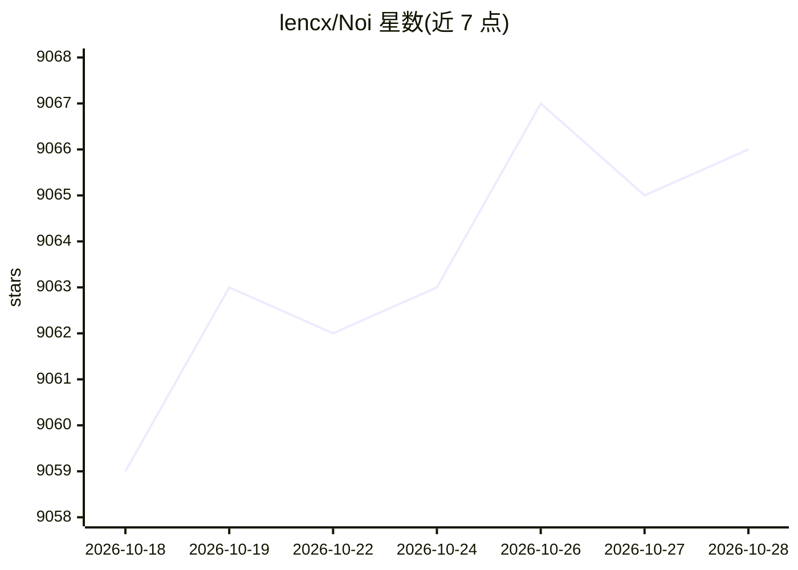

# lencx/Noi

⭐ 9,067 · TypeScript · 推送 2026-08-21 · [GitHub](https://github.com/lencx/Noi) · [官网](https://noib.app) · 个人维护 · 中文 README

**面向多个 AI 站点的桌面浏览器，统一管理与提示词工作流**

Noi 是一款跨平台桌面应用（主题标签含 macOS、browser、extension），定位为 AI 浏览器：以多窗口并行运行各 AI 站点工作区，支持会话隔离、本地优先的历史/提示词/设置存储、面向 AI 对话的提示词管理、内置终端，并提供 noi CLI 命令，可从 Claude Code、Codex、Gemini CLI 等工具控制 Noi。提供多种主题，README 含下载入口与中国用户微信群渠道。

## 筛选速览

| 维度 | 判定 | 备注 |
|---|---|---|
| AI 角色 | `ai-enhanced` | 去掉 AI 部分产品仍成立 |
| 许可风险 | `none` | — |
| 部署形态 | `None` |  |
| 模型依赖 | — | README 未给出锁定关系 |
| 硬件要求 | — | 无带数字的原话,不猜 |
| 安装摩擦 | `low` | 无编译、无系统依赖或容器化 |
| 成熟度 | — | 结构信号不足 |

## 能力要点

- 多窗口管理与会话隔离，并行运行各 AI 站点工作区
- 面向 AI 对话的提示词管理（组织、复用、迭代）
- 本地优先数据：历史、提示词、设置保存在设备上
- noi CLI 可被 Claude Code / Codex / Gemini CLI 等工具调用

## 适用场景

- 把多个 AI 站点集中在同一桌面应用中并行使用
- 跨多个 AI 对话统一管理和复用提示词
- 配合 Claude Code、Codex 等命令行工具控制浏览器

## 场景标签

`提示工程` · 领域:Agent 开发

## 证据(README 行号)

> L16: * **Prompt management for AI chats**: organize, reuse, and iterate on workflows
> L18: * **`noi` CLI command**: control Noi from tools like Claude Code, Codex, and Gemini CLI (more commands coming)

## 星数曲线

2026-10-18 9,059 → 2026-10-28 9,066（+7）

---
*卡片 v1 · prompt 1.4 · 生成 2026-10-20 · 置信度 mid · 依据 README sha `a359d06aef06` · [字段定义](../../DATASET.md)*
