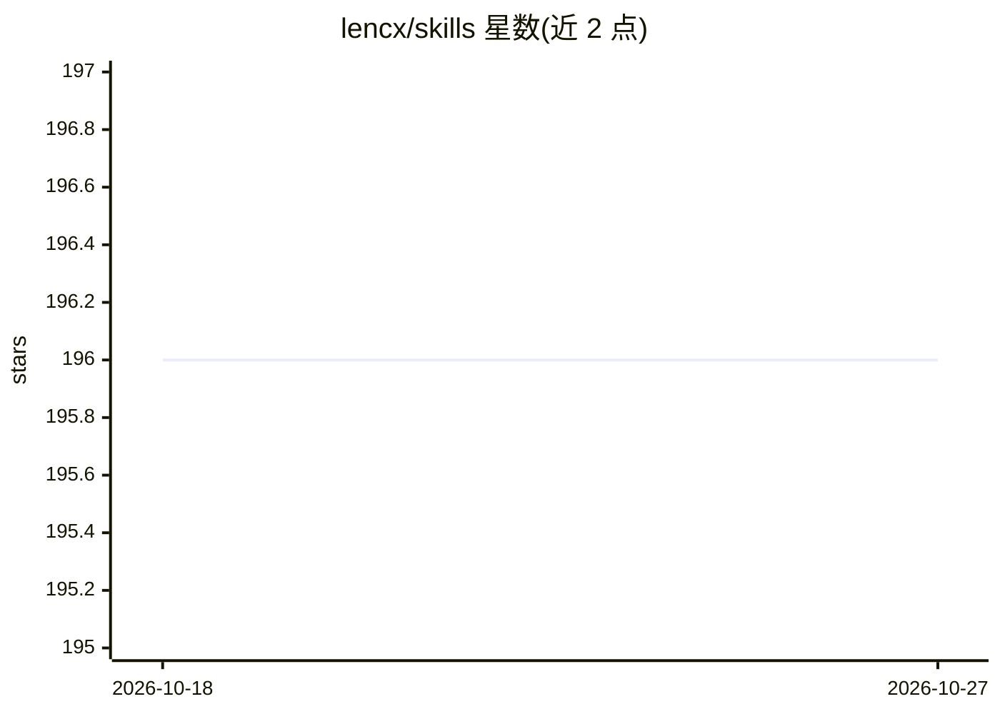

# lencx/skills

⭐ 196 · Shell · MIT · 推送 2026-08-21 · [GitHub](https://github.com/lencx/skills) · [官网](https://skills.lencx.me) · 个人维护 · 中文 README

**面向 Claude Code/Codex 的个人技能库：架构治理与编码协议**

lencx 维护的 agent 技能集合，含两个技能：keel（系统的承重架构设计、评审与治理：权责、契约、依赖与状态边界、恢复、漂移防护、迁移与删除）与 coding-protocol（按风险分级的仓库执行规范与代码证据守则，覆盖目标范围、证据、验证与如实报告）。技能通过 npx skills 安装器或 Codex/Claude Code 原生插件机制安装，二者同时使用会导致技能重复。另推荐 Matt Pocock's Skills、Impeccable 作为互补项目。MIT 许可，中英双语 README。

## 筛选速览

| 维度 | 判定 | 备注 |
|---|---|---|
| AI 角色 | `ai-ecosystem` | LLM/agent 周边工具 |
| 许可风险 | `permissive` | MIT |
| 部署形态 | `library` | 以包/库形式分发 |
| 模型依赖 | — | README 未给出锁定关系 |
| 硬件要求 | — | 无带数字的原话,不猜 |
| 安装摩擦 | `low` | 无编译、无系统依赖或容器化 |
| 成熟度 | — | 结构信号不足 |

## 能力要点

- keel 技能：系统承重架构的设计、评审与治理规范
- coding-protocol 技能：风险分级的仓库执行与代码证据守则
- 支持 npx skills 安装器与 Codex/Claude Code 原生插件两种安装方式
- 中英双语文档，推荐互补技能项目

## 适用场景

- 为 Claude Code 或 Codex agent 添加架构治理与编码规范技能
- 让 agent 在仓库操作中遵循分阶段验证与如实报告的执行协议
- 组合第三方技能扩展设计与工程工作流覆盖

## 场景标签

`提示工程` · 领域:Agent 开发

## 证据(README 行号)

> L20: npx skills@latest add lencx/skills
> L51: - keel: Load-bearing architecture design, review, and governance for new and existing systems—authority, ownership,
> L52: - coding-protocol: Risk-scaled repository execution and code-evidence guardrails for authority, target scope, evide

## 星数曲线

2026-10-18 196 → 2026-10-27 196（+0）

---
*卡片 v1 · prompt 1.4 · 生成 2026-10-22 · 置信度 high · 依据 README sha `dc11662e125a` · [字段定义](../../DATASET.md)*
