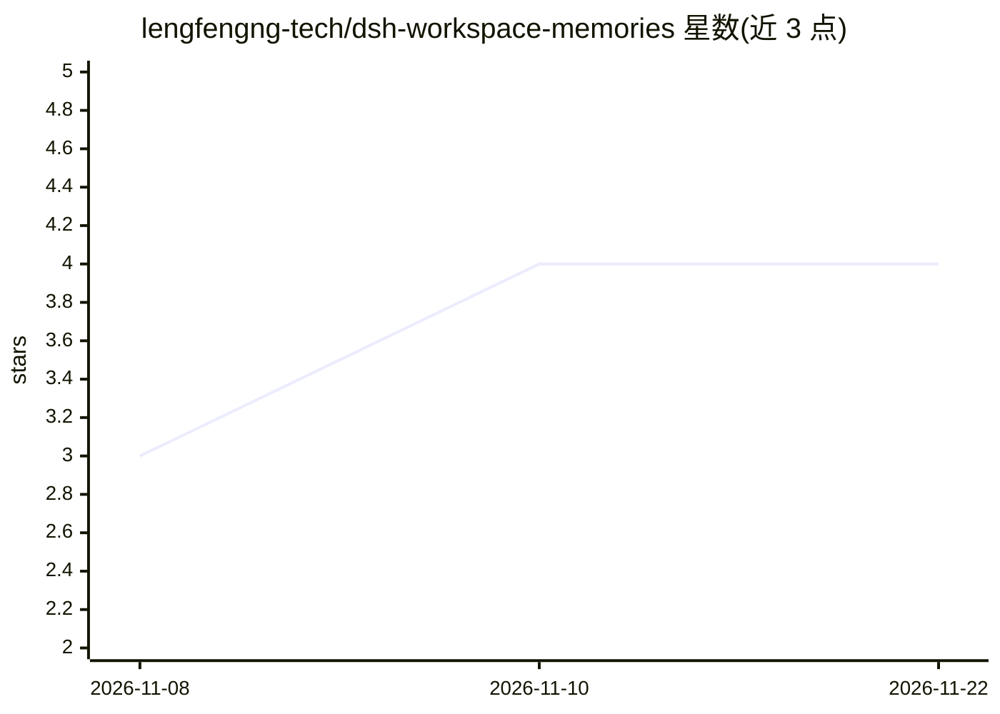

# lengfengng-tech/dsh-workspace-memories

⭐ 4 · JavaScript · MIT · 推送 2026-11-12 · [GitHub](https://github.com/lengfengng-tech/dsh-workspace-memories) · 个人维护 · 中文 README

**为 DSH 提供每工作区持久记忆的插件**

DeepSeek Harness（DSH）的插件，为每个工作区提供独立记忆目录（默认存放在项目外的 DSH 数据目录），并在该工作区每个新会话的系统提示中自动注入全局与工作区记忆文件；同时注册 save_workspace_memory 工具，使 agent 可在用户要求时自行写入记忆。侧边栏面板支持浏览、创建、编辑、删除记忆文件，支持八种语言界面。纯 JavaScript 包无构建步骤，通过 dsh plugin 命令或 GUI 安装；MIT 许可。

## 筛选速览

| 维度 | 判定 | 备注 |
|---|---|---|
| AI 角色 | `ai-ecosystem` | LLM/agent 周边工具 |
| 许可风险 | `permissive` | MIT |
| 部署形态 | `None` |  |
| 模型依赖 | — | README 未给出锁定关系 |
| 硬件要求 | — | 无带数字的原话,不猜 |
| 安装摩擦 | `low` | 无编译、无系统依赖或容器化 |
| 成熟度 | — | 结构信号不足 |

## 能力要点

- 每工作区独立记忆目录，默认存放于项目外的 ~/.dsh/workspace-memory/
- 记忆文件自动注入系统提示，新会话即时携带
- save_workspace_memory 工具支持 agent 自主写入，含全局 scope
- 侧边栏面板管理记忆文件，八语言本地化界面

## 适用场景

- 让 agent 跨会话记住项目决策、服务器地址等机器本地信息
- 将个人工作偏好作为全局记忆应用于所有项目
- 团队将共享记忆随代码一起版本化（workspace 存储模式）

## 场景标签

`Agent 记忆` · 领域:Agent 开发

## 证据(README 行号)

> L5: **Per-workspace persistent memory for DeepSeek Harness (DSH)** — a plugin that gives every workspace its own durable
> L15: 3. **The agent can write memories itself** — a global `save_workspace_memory` tool lets any session persist a decis

## 星数曲线

2026-11-08 3 → 2026-11-22 4（+1）

---
*卡片 v1 · prompt 1.4 · 生成 2026-11-21 · 置信度 high · 依据 README sha `ab3a8a0df945` · [字段定义](../../DATASET.md)*
