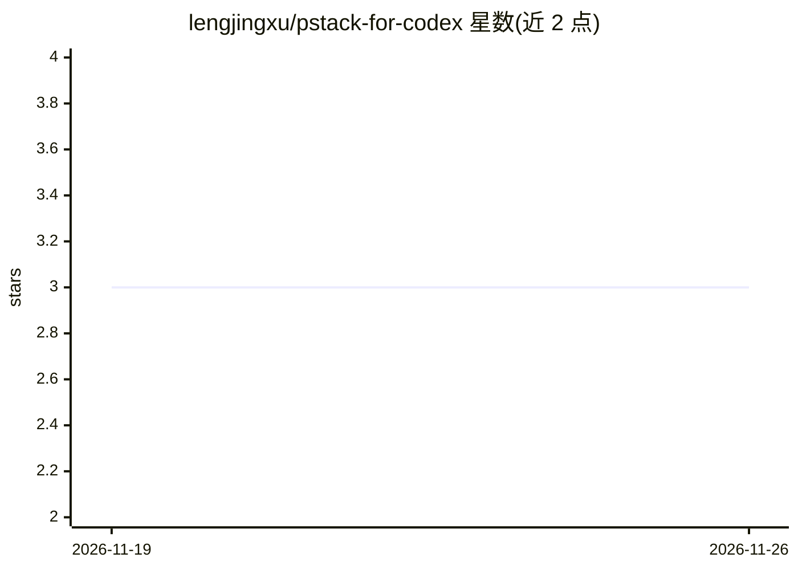

# lengjingxu/pstack-for-codex

⭐ 3 · TypeScript · MIT · 推送 2026-10-21 · [GitHub](https://github.com/lengjingxu/pstack-for-codex) · 个人维护

**Codex 用户的 pstack 工作流移植：技能、playbook 与原则集**

将 Lauren Tan 为 Cursor 构建的 pstack 方法移植到 Codex：55 个技能、23 个 playbook、24 条原则加 1 个路由技能（$poteto-mode），要求 agent 工作可规划、有运行时证据、验证后才算完成。移植将 Cursor 专有机制映射到 Codex 原语（spawn_agent、$CODEX_HOME/skills、会话日志等），无等价物时明确说明并继续。提供 git clone + install.sh 或手动拷贝安装，支持 5 种语言文档。

## 筛选速览

| 维度 | 判定 | 备注 |
|---|---|---|
| AI 角色 | `ai-ecosystem` | LLM/agent 周边工具 |
| 许可风险 | `permissive` | MIT |
| 部署形态 | `None` |  |
| 模型依赖 | — | README 未给出锁定关系 |
| 硬件要求 | — | 无带数字的原话,不猜 |
| 安装摩擦 | `low` | 无编译、无系统依赖或容器化 |
| 成熟度 | `idea` | |

## 能力要点

- 55 skills、23 playbooks、24 principles、1 个路由技能（$poteto-mode）
- 将 Cursor 机制映射到 Codex 原语，无等价物时明确声明
- 除 setup-pstack 外均为显式调用，避免技能列表超出上下文预算
- 文档提供 EN/简体中文/FR/JA/KO 五种语言

## 适用场景

- 为 Codex 使用者提供可重复的 agent 工程流程
- 需要运行时证据与完成前验证的团队协作
- 为将 pstack 移植到其他宿主提供参考实现

## 场景标签

`提示工程` `编码 Agent` · 领域:Agent 开发

## 证据(README 行号)

> L15: **pstack for Codex** is a Codex-native port of pstack by Lauren Tan. Same working method, same playbooks, same prin
> L19: > **TL;DR** — 55 skills, 23 playbooks, 24 principles, one routing skill. For Codex users who want agent work that i
> L46: Not for: raw model-speed benchmarks or zero-config autopilot. pstack is a workflow layer; the model still does the 

## 星数曲线

2026-11-19 3 → 2026-11-26 3（+0）

---
*卡片 v1 · prompt 1.4 · 生成 2026-11-21 · 置信度 high · 依据 README sha `15ae5208180b` · [字段定义](../../DATASET.md)*
