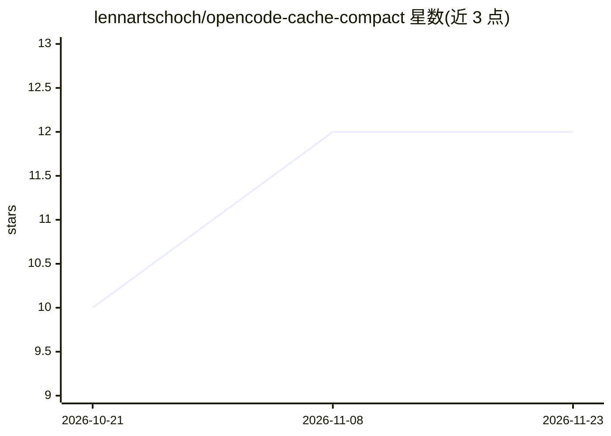

# lennartschoch/opencode-cache-compact

⭐ 12 · TypeScript · MIT · 推送 2026-09-24 · [GitHub](https://github.com/lennartschoch/opencode-cache-compact) · 个人维护

**OpenCode 插件：追加式摘要压缩上下文以保留提示缓存**

面向本地托管模型的 OpenCode V1/V2 插件，解决压缩时重建提示导致缓存失效、整个上下文被重新 prefill 的问题。机制为在上下文接近窗口上限时追加一条普通用户轮请求交接摘要（缓存命中），此后将发往模型的请求裁剪为稳定前缀加摘要与当前轮，并发送 continue 轮自动恢复；会话文件不被修改。要求模型 provider 上报上下文窗口，通过 OpenCode 的实验性 hook（V1）或 context 事件（V2 beta）接入，按 modelID 范围生效，不影响云端会话。

## 筛选速览

| 维度 | 判定 | 备注 |
|---|---|---|
| AI 角色 | `ai-ecosystem` | LLM/agent 周边工具 |
| 许可风险 | `permissive` | MIT |
| 部署形态 | `library` | 以包/库形式分发 |
| 模型依赖 | — | README 未给出锁定关系 |
| 硬件要求 | — | 无带数字的原话,不猜 |
| 安装摩擦 | `low` | 无编译、无系统依赖或容器化 |
| 成熟度 | — | 结构信号不足 |

## 能力要点

- 追加式摘要：不重建提示，前缀由服务端缓存命中
- 仅改写发往模型的请求，磁盘会话保持完整
- 可在回合中途触发并中止运行中的回合，防止长 agentic 循环越界
- 支持按 providerID/modelID 限定生效范围与 threshold 等多项配置

## 适用场景

- 本地大上下文模型下减少压缩后漫长的重新 prefill 等待
- 长 agentic 编码会话中自动维持上下文在窗口内
- 只对本地端点启用压缩而不影响云模型会话

## 场景标签

`编码 Agent` `Agent 记忆` · 领域:Agent 开发

## 证据(README 行号)

> L3: **Cache-friendly context compaction for OpenCode V1 and V2.**
> L13: On a locally hosted model, prefilling a large context window is slow: the longer the conversation, the longer the w
> L17: 1. **Summarize by appending.** When the context approaches the model's limit, it appends an ordinary user turn aski

## 星数曲线

2026-10-21 10 → 2026-11-23 12（+2）

---
*卡片 v1 · prompt 1.4 · 生成 2026-11-18 · 置信度 high · 依据 README sha `488b947c076a` · [字段定义](../../DATASET.md)*
