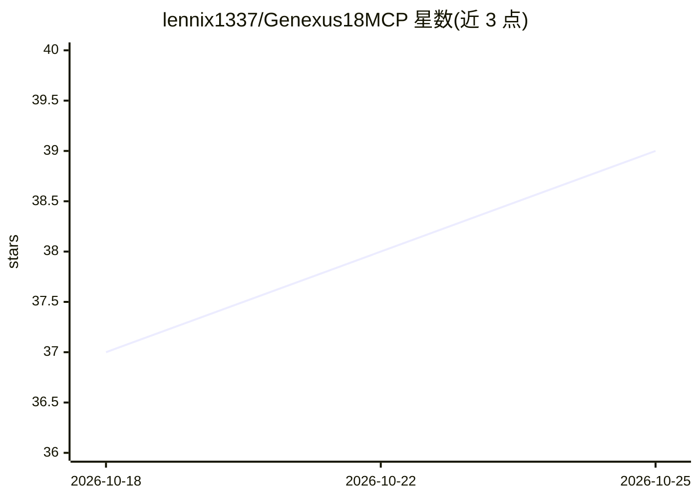

# lennix1337/Genexus18MCP

⭐ 39 · C# · MIT · 推送 2026-10-23 · [GitHub](https://github.com/lennix1337/Genexus18MCP) · [官网](https://www.npmjs.com/package/genexus-mcp) · 个人维护

**GeneXus MCP 服务器：让 AI 代理读写重构 GeneXus 知识库**

面向 Claude Desktop、Claude Code、Cursor 等 MCP 兼容客户端的服务器：通过官方原生 SDK（GeneXus 16/17/18）或遗留兼容驱动（GX8/9/Evolution 1–3/15，经 .NET 反射与 GXPublic COM 接入）连接 GeneXus 知识库，让 AI 代理列出事务、添加规则、重构过程并触发构建。包含实验性 Rust gx-engine 后端用于构建加速，其全 SDK 替代尚未验证，读编辑仍回落 SDK。以 npm/npx 分发，需本机装有 GeneXus。

## 筛选速览

| 维度 | 判定 | 备注 |
|---|---|---|
| AI 角色 | `ai-ecosystem` | LLM/agent 周边工具 |
| 许可风险 | `permissive` | MIT |
| 部署形态 | `desktop` | 安装包/桌面程序 |
| 模型依赖 | — | README 未给出锁定关系 |
| 硬件要求 | — | 无带数字的原话,不猜 |
| 安装摩擦 | `high` | 编译与系统依赖俱全 |
| 成熟度 | `idea` | |

## 能力要点

- 原生 SDK 支持 GeneXus 16/17/18，遗留版本经 dotnet-reflection/com-gxpublic 驱动
- 按 KB 路由不同 SDK/驱动，genexus_whoami 报告检测到的 SDK 与支持级别
- 实验性 Rust gx-engine 后端（默认引擎路由，读编辑回落 SDK）
- doctor 与 kb_sdk_compatibility 检查，SDK/KB 主版本冲突时中止写配置

## 适用场景

- 在 Claude/Cursor 中用自然语言查询和修改 GeneXus 知识库对象
- 维护多个 GeneXus 版本知识库并按 KB 切换 SDK
- 加速 GeneXus 全库重建的构建流程（实验性引擎）

## 场景标签

`编码 Agent` · 领域:编码与开发

## 证据(README 行号)

> L14: **GeneXus MCP Server** lets AI agents — Claude Desktop, Claude Code, Cursor, Antigravity, and any MCP-compatible cl
> L16: In practice: you point the MCP at your KB, then ask your AI assistant things like *"list all transactions with attr

## 星数曲线

2026-10-18 37 → 2026-10-25 39（+2）

---
*卡片 v1 · prompt 1.4 · 生成 2026-10-25 · 置信度 high · 依据 README sha `11e882d01d66` · [字段定义](../../DATASET.md)*
