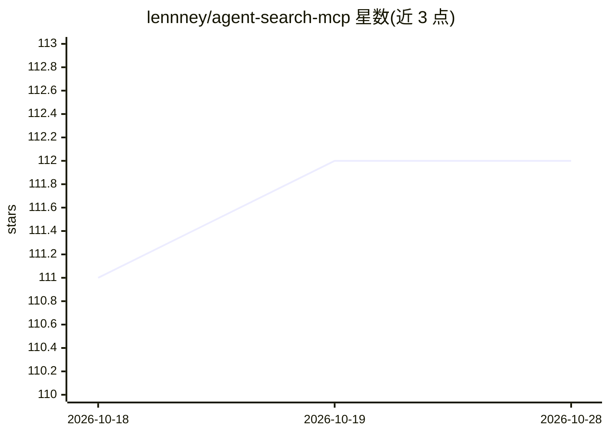

# lennney/agent-search-mcp

⭐ 111 · TypeScript · Apache-2.0 · 推送 2026-09-21 · [GitHub](https://github.com/lennney/agent-search-mcp) · [官网](https://take-a-deep-breath0.com/en/agent-search-mcp) · 个人维护 · 中文 README

**给 AI agent 的免密钥中英网页搜索 MCP 服务器，返回可核查证据**

Node.js 实现的 MCP 服务器与 CLI，为 AI agent 提供多引擎网页搜索、URL 转 Markdown、GitHub/CSDN/掘金文章抓取等 7 个只读工具。注册 16 个适配器（9 个零密钥如 DuckDuckGo/搜狗/百度，7 个可选 API 适配器如 Brave/Tavily），默认 free_first 路由不消耗付费凭据。响应包含证据包：来源家族计数、停止原因、预算与 partialFailures，上游失败对 agent 可见；请求与证据预算限制 token 消耗，compact 模式实测节省约 31%。需 Node.js >= 18.17，语义去重等可选功能才用到 Python。

## 筛选速览

| 维度 | 判定 | 备注 |
|---|---|---|
| AI 角色 | `ai-ecosystem` | LLM/agent 周边工具 |
| 许可风险 | `permissive` | Apache-2.0 |
| 部署形态 | `library` | 以包/库形式分发 |
| 模型依赖 | — | README 未给出锁定关系 |
| 硬件要求 | — | 无带数字的原话,不猜 |
| 安装摩擦 | `low` | 无编译、无系统依赖或容器化 |
| 成熟度 | — | 结构信号不足 |

## 能力要点

- 16 个搜索引擎适配器（9 个零密钥 + 7 个可选 API）
- 证据包含来源家族计数、stop_reason、预算与 partialFailures，失败不隐藏
- 请求/证据双预算控制 token 消耗，compact 模式实测节省约 31%
- 中英双语搜索（搜狗/百度直查中文，无翻译层）

## 适用场景

- 给 Claude Desktop/Cursor 等 MCP 客户端接入无需 API key 的网页搜索
- agent 检索时核查证据来源与失败情况
- 控制搜索成本与响应 token 体积

## 场景标签

`网页抓取` · 领域:效率与自动化

## 证据(README 行号)

> L3: **A Node.js MCP server and CLI for English and Chinese web search.**
> L29: Use this stdio configuration in MCP clients that accept `mcpServers` JSON,
> L157:     A["AI agent"] --> M["MCP search tools"]

## 星数曲线

2026-10-18 111 → 2026-10-28 112（+1）

---
*卡片 v1 · prompt 1.4 · 生成 2026-10-23 · 置信度 high · 依据 README sha `06ef76197183` · [字段定义](../../DATASET.md)*
