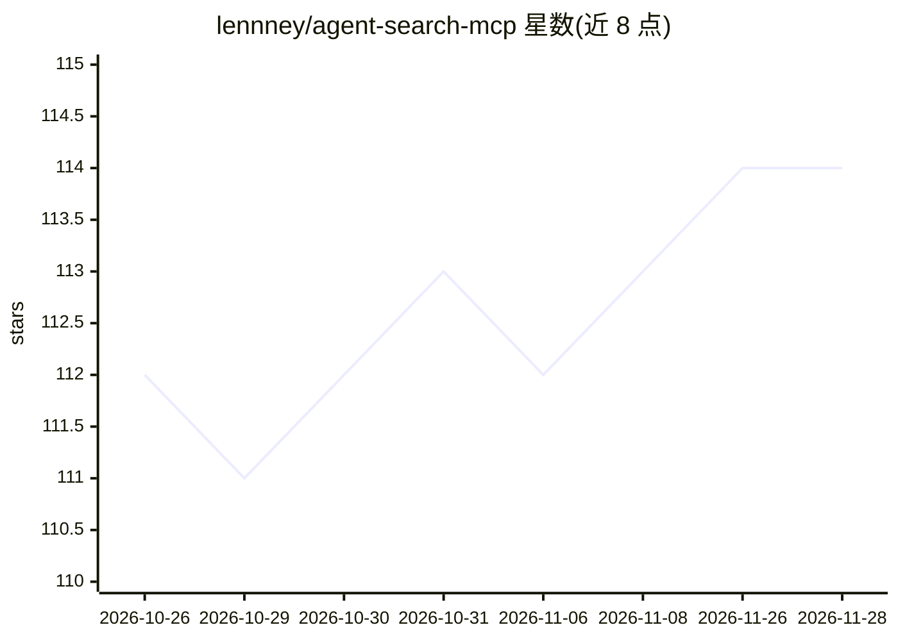

# lennney/agent-search-mcp

⭐ 114 · TypeScript · Apache-2.0 · 推送 2026-11-10 · [GitHub](https://github.com/lennney/agent-search-mcp) · [官网](https://take-a-deep-breath0.com/en/agent-search-mcp) · 个人维护 · 中文 README

**零 key 中英文网页搜索 MCP 服务器：给 AI agent 提供可检验的多源证据**

Node.js 实现的 MCP 服务器与 CLI，默认无需 API key 即可运行：注册 17 个搜索引擎适配器（9 个零 key、8 个需凭据），按 free_first/free_only/quality_escalation/paid_first 等路由策略执行带预算约束的搜索；每次响应携带证据包，包含执行的适配器、停止原因、质量门、预算与 partialFailures 失败记录，防止上游失败被隐藏为空结果。支持 stdio 与 Streamable HTTP 两种接入方式，可配置代理池、缓存与可选的 Python 语义去重/重排。

## 筛选速览

| 维度 | 判定 | 备注 |
|---|---|---|
| AI 角色 | `ai-ecosystem` | LLM/agent 周边工具 |
| 许可风险 | `permissive` | Apache-2.0 |
| 部署形态 | `library` | 以包/库形式分发 |
| 模型依赖 | — | README 未给出锁定关系 |
| 硬件要求 | — | 无带数字的原话,不猜 |
| 安装摩擦 | `low` | 无编译、无系统依赖或容器化 |
| 成熟度 | — | 结构信号不足 |

## 能力要点

- 17 个引擎适配器：9 个零 key（DuckDuckGo/搜狗/必应/百度等）+ 8 个可选 API 提供方
- 响应内含 Search Evidence Packet 与 partialFailures，上游失败对 agent 保持可见
- 请求预算（适配器尝试/耗时/结果数）与证据字符预算控制 token 成本
- 提供 7 个 MCP 工具：多引擎搜索、URL 提取、GitHub README 与中文技术文章抓取等

## 适用场景

- 让 Claude Desktop/Cursor 等 MCP 客户端直接进行免 key 中英文搜索
- 验证事实声明时引用带独立来源计数的证据
- 在中文查询上直接走搜狗/百度，不经过翻译层
- 自托管一个可控制付费策略与成本的搜索服务

## 场景标签

`网页抓取` · 领域:效率与自动化

## 证据(README 行号)

> L3: **A Node.js MCP server and CLI for English and Chinese web search.**
> L157:     A["AI agent"] --> M["MCP search tools"]
> L178: The runtime registers 17 adapters: 9 zero-key adapters and 8 optional API adapters.

## 星数曲线

2026-10-26 112 → 2026-11-28 114（+2）

---
*卡片 v1 · prompt 1.4 · 生成 2026-11-28 · 置信度 high · 依据 README sha `b1b46c841e1a` · [字段定义](../../DATASET.md)*
