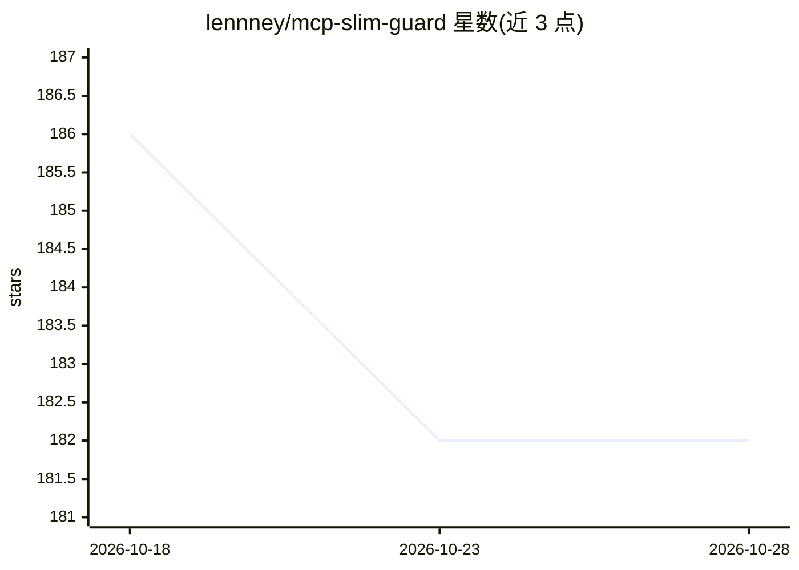

# lennney/mcp-slim-guard

⭐ 182 · TypeScript · MIT · 推送 2026-08-14 · [GitHub](https://github.com/lennney/mcp-slim-guard) · [官网](https://take-a-deep-breath0.com/en/mcp-slim-guard) · 个人维护

**MCP 工具调用网关：授权过滤、schema 校验与结果可恢复交付**

面向 MCP 宿主（Codex、Claude Code）的代理层：通过 allow/deny 白名单授权上游工具，在调用前按原始 schema 校验参数（不合规则返回错误且不触达上游），并压缩超大结果——首响应返回 result_ref，宿主可用 read_result 精确恢复原始快照而无需重复调用。提供 Native/Compact/Extreme 三种宿主可见面模式，含 24 任务对比与 100 工具压力测试夹具。当前为 0.1.1-alpha.2 源码候选，未发布 npm，需从源码构建安装。

## 筛选速览

| 维度 | 判定 | 备注 |
|---|---|---|
| AI 角色 | `ai-ecosystem` | LLM/agent 周边工具 |
| 许可风险 | `permissive` | MIT |
| 部署形态 | `None` |  |
| 模型依赖 | — | README 未给出锁定关系 |
| 硬件要求 | — | 无带数字的原话,不猜 |
| 安装摩擦 | `low` | 无编译、无系统依赖或容器化 |
| 成熟度 | `idea` | |

## 能力要点

- 调用前按原始 schema 校验，失败时确认上游未被调用
- result_ref + read_result 精确恢复结果快照，不重复调用上游
- Native/Compact/Extreme 三种宿主表面模式与统一 allow/deny 授权
- find_tool 拒绝未知字段与超过 256 码点的查询，不回退到未授权条目

## 适用场景

- 限制 MCP 宿主只能访问授权的工具目录
- 压缩超大的 MCP 工具结果以节省上下文，需要时精确恢复
- 在调用上游前拦截参数不合规的工具调用

## 场景标签

 · 领域:AI 基础设施/MCP 网关

## 证据(README 行号)

> L3: MCP Slim Guard gives a host one deliberate way to reach authorized upstream
> L5: invoked, and can recover an oversized result exactly without repeating that

## 星数曲线

2026-10-18 186 → 2026-10-28 182（-4）

---
*卡片 v1 · prompt 1.4 · 生成 2026-10-22 · 置信度 high · 依据 README sha `0633a0d6d483` · [字段定义](../../DATASET.md)*
