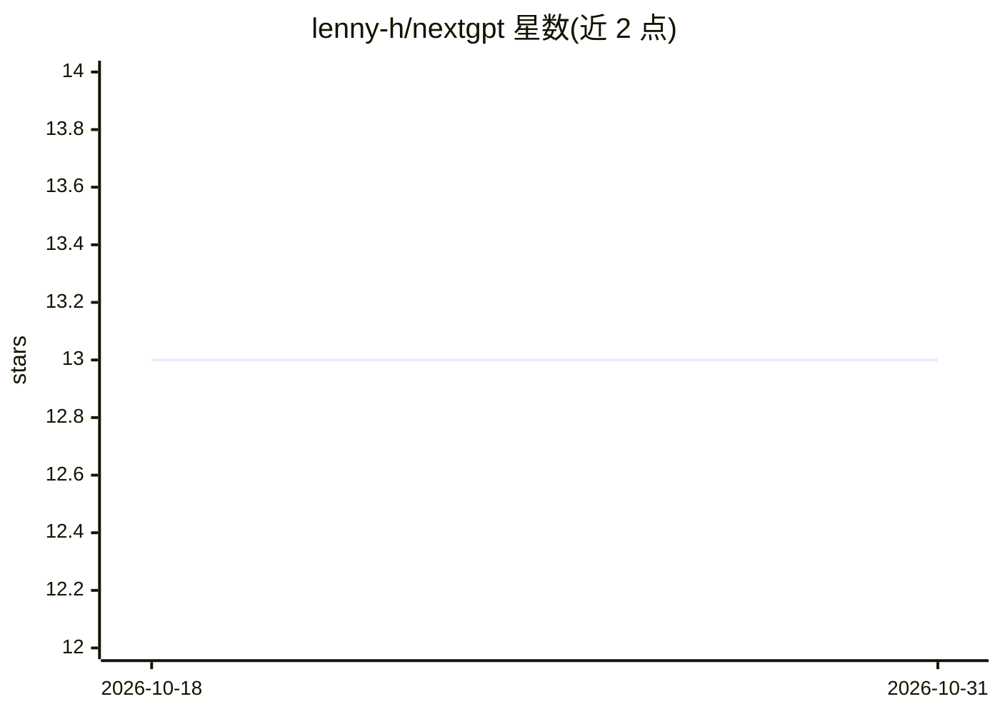

# lenny-h/nextgpt

⭐ 13 · TypeScript · NOASSERTION · 推送 2026-02-28 · [GitHub](https://github.com/lenny-h/nextgpt) · 个人维护

**面向企业的自托管 AI 聊天平台，集成文档与网页搜索**

Next.js 聊天界面 + 自定义 API + 文档处理/PDF 生成/网页抓取（Firecrawl）微服务的 monorepo，使用 PostgreSQL（pgvector）实现向量检索与 RAG，覆盖聊天、文档搜索、网页搜索与维护者仪表盘。面向希望掌控数据主权的企业，可部署到 AWS 或 Google Cloud（Azure 尚未支持），本地通过 Docker Compose 起基础服务、pnpm 启动应用。README 提示 Firecrawl 存在缺陷，生产环境不推荐使用，建议改用 Vercel AI SDK 文档中的搜索方案或托管替代品。

## 筛选速览

| 维度 | 判定 | 备注 |
|---|---|---|
| AI 角色 | `ai-native` | 本体是模型或模型工具 |
| 许可风险 | `none` | NOASSERTION |
| 部署形态 | `self-host` | docker 或自建部署 |
| 模型依赖 | — | README 未给出锁定关系 |
| 硬件要求 | — | 无带数字的原话,不猜 |
| 安装摩擦 | `low` | 无编译、无系统依赖或容器化 |
| 成熟度 | — | 结构信号不足 |

## 能力要点

- PostgreSQL + pgvector 向量检索支撑 RAG 与语义搜索
- 集成文档处理、PDF 导出、Firecrawl 网页抓取微服务
- 提供 AWS 与 Google Cloud 部署指南，本地 Docker Compose 全套服务
- Keycloak SSO 与维护者文档上传/权限配置仪表盘

## 适用场景

- 企业内部部署自有 AI 问答界面并掌控数据
- 带文档库与网页搜索的对话式知识检索
- 通过仪表盘上传文档并配置访问权限

## 场景标签

`聊天机器人` `RAG` `文档问答` · 领域:对话与助手

## 证据(README 行号)

> L3: NextGPT is a platform designed to deploy a secure AI interface with integrated document and web search capabilities 
> L14: Chat interface with AI-powered conversations, document search, and web search capabilities

## 星数曲线

2026-10-18 13 → 2026-10-31 13（+0）

---
*卡片 v1 · prompt 1.4 · 生成 2026-10-31 · 置信度 high · 依据 README sha `04dc9e5cb949` · [字段定义](../../DATASET.md)*
