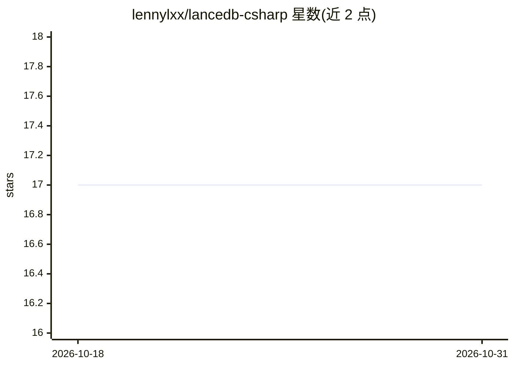

# lennylxx/lancedb-csharp

⭐ 17 · C# · Apache-2.0 · 推送 2026-07-06 · [GitHub](https://github.com/lennylxx/lancedb-csharp) · [官网](https://www.nuget.org/packages/LanceDB) · 个人维护

**LanceDB 的 C# SDK：通过 FFI 封装 Rust 原生库**

面向 .NET 开发者的 LanceDB 嵌入式向量数据库 C# SDK，通过 P/Invoke 封装官方 Rust lancedb crate，提供 async API，功能与 Python SDK 对齐。支持连接本地/云端数据库、表 CRUD、向量/全文/混合搜索、类型安全过滤、多种索引（BTree/IVF/HNSW 等）、模式管理、版本与命名空间管理。原生层使用 Tokio 运行时池按 CPU 核心分发任务，并发下可达约 100% 原生 Rust 吞吐（lancedb crate 场景）。NuGet 包内置 Linux x64/Windows x64/macOS arm64 预编译原生库，无需 Rust 工具链；从源码构建需 .NET 10 SDK 与 Rust 1.93.1。

## 筛选速览

| 维度 | 判定 | 备注 |
|---|---|---|
| AI 角色 | `ai-ecosystem` | LLM/agent 周边工具 |
| 许可风险 | `permissive` | Apache-2.0 |
| 部署形态 | `None` |  |
| 模型依赖 | — | README 未给出锁定关系 |
| 硬件要求 | — | 无带数字的原话,不猜 |
| 安装摩擦 | `medium` | 含编译或系统依赖之一 |
| 成熟度 | — | 结构信号不足 |

## 能力要点

- P/Invoke 封装官方 Rust lancedb crate，提供 async C# API
- 向量/全文/混合搜索，含 RRF 等重排策略
- IVF-PQ/HNSW 等 10 种索引类型与模式/版本管理
- NuGet 包内置三平台预编译原生库，无需 Rust 工具链

## 适用场景

- 在 .NET 应用中嵌入向量数据库做相似度检索
- 构建带混合搜索的 C# RAG 数据层
- 多租户场景下用命名空间组织表

## 场景标签

`向量数据库` · 领域:知识与检索

## 证据(README 行号)

> L3: A C# SDK for LanceDB — the developer-friendly embedded vector database. This SDK wraps the official Rust `lancedb` c
> L9: - **Vector search** — nearest-neighbor queries with distance metrics, nprobes, refine factor, multi-vector search

## 星数曲线

2026-10-18 17 → 2026-10-31 17（+0）

---
*卡片 v1 · prompt 1.4 · 生成 2026-10-29 · 置信度 high · 依据 README sha `0199a24e1c3d` · [字段定义](../../DATASET.md)*
