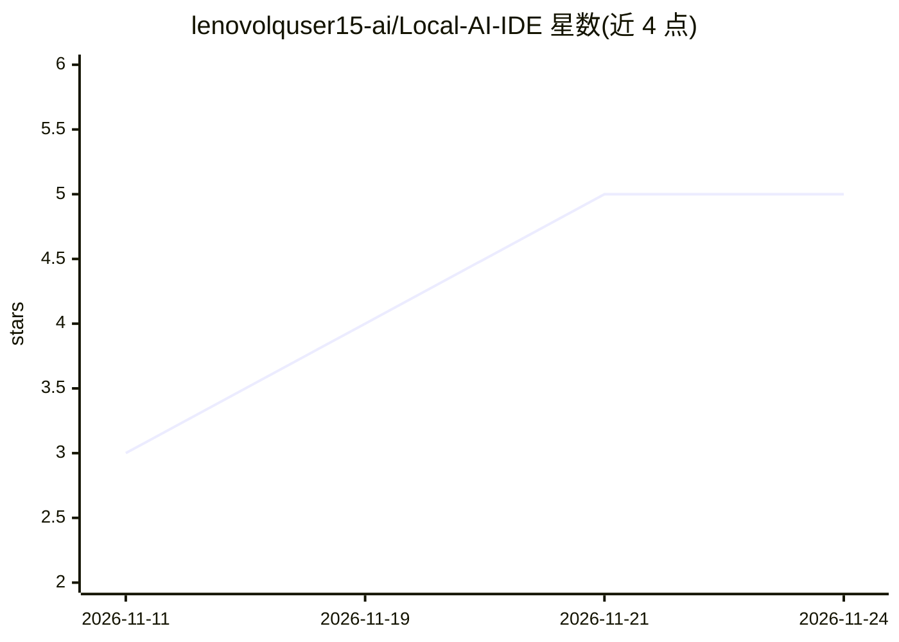

# lenovolquser15-ai/Local-AI-IDE

⭐ 5 · Python · MIT · 推送 2026-11-21 · [GitHub](https://github.com/lenovolquser15-ai/Local-AI-IDE) · [官网](https://t.me/RemingOstai) · 个人维护

**基于本地 LLM 的 Windows 桌面 agent harness，带 Web UI 与工具调用**

面向本地运行的 LLM（LM Studio / Ollama）提供的 agent harness：在 127.0.0.1:7788 提供 Web UI，agent 可调用 shell、文件、浏览器（CDP）、多引擎网页搜索等工具；支持目标模式与自动上下文压缩、会话历史与 Markdown 导出、长期记忆（remember/recall）、图片输入与 Stable Diffusion WebUI/ComfyUI 图片生成、Windows 托盘与开机自启、局域网手机 QR 接入及经 Cloudflare Worker 的远程访问。Windows 提供安装包，也可从 Python 3.10+ 源码运行。文档为俄文。

## 筛选速览

| 维度 | 判定 | 备注 |
|---|---|---|
| AI 角色 | `ai-ecosystem` | LLM/agent 周边工具 |
| 许可风险 | `permissive` | MIT |
| 部署形态 | `desktop` | 安装包/桌面程序 |
| 模型依赖 | local-ok | 支持本地模型 |
| 硬件要求 | — | 无带数字的原话,不猜 |
| 安装摩擦 | `low` | 无编译、无系统依赖或容器化 |
| 成熟度 | — | 结构信号不足 |

## 能力要点

- 接入 LM Studio / Ollama 本地模型，工具集含 shell/文件/CDP 浏览器/多引擎搜索
- 目标模式（goal mode）带自动上下文压缩与就绪判据清单
- 长期记忆 remember/recall 与插件目录，GitHub 仓库可转插件
- 局域网 QR 手机接入与 Cloudflare 隧道远程访问（临时码 + 签名 cookie）

## 适用场景

- 在本地模型上运行可操作本机文件、shell 与浏览器的 agent
- 断网或隐私敏感场景下用本地 LLM 处理任务
- 通过手机或远程访问家里电脑上的 agent 会话

## 场景标签

`AI 助手` `浏览器自动化` · 领域:效率与自动化

## 证据(README 行号)

> L3: > Local agent harness for local LLMs (LM Studio / Ollama). Web UI on `127.0.0.1:7788`,
> L88: - **провайдер / модель** — LM Studio (`127.0.0.1:1234/v1`), Ollama (`11434/v1`) или Strata MoE (`127.0.0.1:8080/v1`
> L89: - **набор инструментов** — `core` (базовые) и `full` (плюс окна, процессы, браузер через CDP, скачивание, lmstudio)

## 星数曲线

2026-11-11 3 → 2026-11-24 5（+2）

---
*卡片 v1 · prompt 1.4 · 生成 2026-11-21 · 置信度 low · 依据 README sha `9ebf48c50f2f` · [字段定义](../../DATASET.md)*
