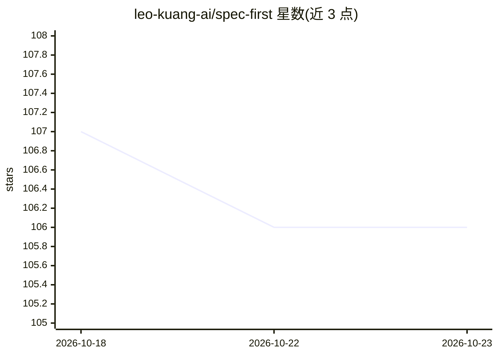

# leo-kuang-ai/spec-first

⭐ 106 · JavaScript · MIT · 推送 2026-10-18 · [GitHub](https://github.com/leo-kuang-ai/spec-first) · [官网](http://spec-first.cn/) · 个人维护 · 中文 README

**面向多种 AI coding 宿主的仓库原生工作流 Harness**

spec-first 是 npm 分发的 CLI 工具，为 Claude Code、Codex、Kiro、Cursor、OpenCode 等宿主生成仓库内 runtime 入口，把想法、需求、计划、代码、审查和知识连接为 Intent→Spec→Plan→Tasks→Code→Review→Knowledge 的闭环。它本身不执行模型调用：脚本准备事实、LLM 做语义判断、项目 owner 授权副作用。提供 spec-brainstorm/spec-plan/spec-work/spec-code-review 等 Skill 入口，产物落在 docs/plans/ 与 docs/solutions/。需要 Node.js≥20、Git 与至少一个宿主 CLI；Kiro/Qoder/ZCode/Pi 等宿主处于 opt-in preview 阶段。

## 筛选速览

| 维度 | 判定 | 备注 |
|---|---|---|
| AI 角色 | `ai-ecosystem` | LLM/agent 周边工具 |
| 许可风险 | `permissive` | MIT |
| 部署形态 | `library` | 以包/库形式分发 |
| 模型依赖 | — | README 未给出锁定关系 |
| 硬件要求 | — | 无带数字的原话,不猜 |
| 安装摩擦 | `medium` | 含编译或系统依赖之一 |
| 成熟度 | `idea` | |

## 能力要点

- 支持 8 种 AI coding 宿主（Claude Code/Codex 为主要支持，其余多为 preview）
- 提供 spec-runtime-setup、spec-brainstorm、spec-plan、spec-work、spec-code-review 等约 30 个 Skill 入口
- 完成声明以命令、exit code、日志等可回源证据为准，不信任“模型说已完成”
- 知识沉淀到 docs/solutions/，带来源、适用范围和失效条件

## 适用场景

- 在使用 Claude Code/Codex 等宿主时保留跨会话的意图、计划与验证证据
- 团队需要跨宿主共享同一套 spec-* workflow 入口
- 把已验证的解法沉淀回项目供复用

## 场景标签

`编码 Agent` `代码审查` `Agent 框架` · 领域:Agent 开发

## 证据(README 行号)

> L5: `spec-first` 是面向 Claude Code、Codex、Kiro、Qoder、Cursor、OpenCode、ZCode 与 Pi 的仓库原生 AI Coding Harness。它把想法、需求、计划、代码、审查和知识
> L26: AI coding 宿主擅长生成和修改代码，但一次会话结束后，意图、范围、取舍、验证证据和未决风险很容易丢失。`spec-first` 将这些内容保留在项目边界内，并让不同宿主可以消费同一套 `spec-*` workflow 入
> L31: - **spec-first**负责连接 intent、context、scope、artifact、claim、evidence 和 handoff。

## 星数曲线

2026-10-18 107 → 2026-10-23 106（-1）

---
*卡片 v1 · prompt 1.4 · 生成 2026-10-23 · 置信度 high · 依据 README sha `65010e820a25` · [字段定义](../../DATASET.md)*
