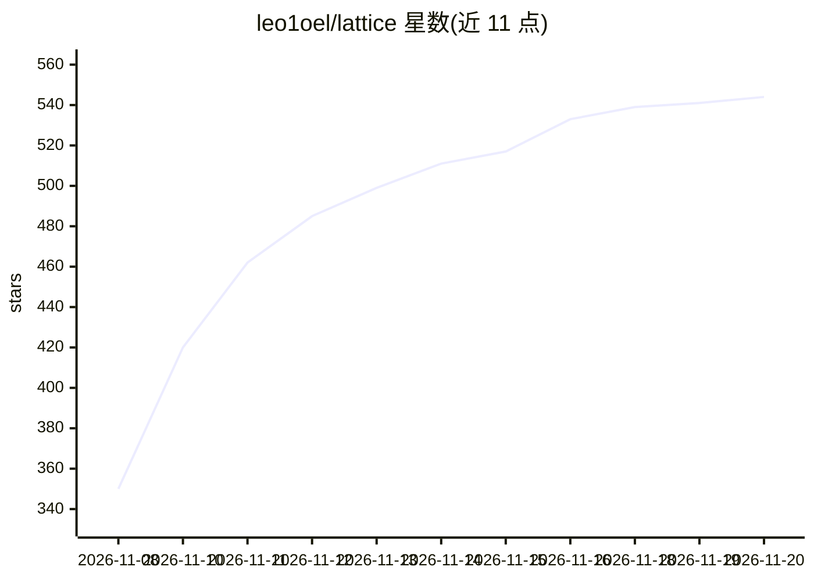

# leo1oel/lattice

⭐ 544 · Rust · Apache-2.0 · 推送 2026-11-19 · [GitHub](https://github.com/leo1oel/lattice) · [官网](https://leo1oel.github.io/lattice/) · 个人维护 · 中文 README

**macOS 本地优先的 LaTeX 写作应用，集成 AI agent 与 Overleaf 同步**

面向论文作者的 macOS 原生 LaTeX 工作区：源码与 PDF 并排、SyncTeX 双向跳转、可视化编辑、NeurIPS/ICML 等会议模板与 arXiv 导出；内置论文库（arXiv ID/DOI/Zotero 导入，Crossref 引文核查）与双向 Overleaf 同步（评论、在线状态、修订跟踪）。AI 部分为可自带 agent：运行 Claude Code、Codex 等 CLI，或接入 OpenAI/Anthropic 兼容 API（经 Synara 运行时），本产品不附带模型与订阅；agent 修改以 diff 呈现可撤销。以 .dmg/Homebrew 安装，需自备 TeX Live/MacTeX；Linux 与 Windows 为实验性且功能受限。

## 筛选速览

| 维度 | 判定 | 备注 |
|---|---|---|
| AI 角色 | `ai-enhanced` | 去掉 AI 部分产品仍成立 |
| 许可风险 | `permissive` | Apache-2.0 |
| 部署形态 | `desktop` | 安装包/桌面程序 |
| 模型依赖 | — | README 未给出锁定关系 |
| 硬件要求 | — | 无带数字的原话,不猜 |
| 安装摩擦 | `low` | 无编译、无系统依赖或容器化 |
| 成熟度 | `idea` | |

## 能力要点

- Agent 面板运行 Claude Code/Codex 等 CLI 或 OpenAI/Anthropic 兼容 API，自带密钥存 Keychain
- 双向 Overleaf 同步：在线状态、评论、修订跟踪，协作者无需安装本产品
- 论文库支持 arXiv ID/DOI/BibTeX/Zotero 导入，Check references 依据 Crossref 审计参考文献
- 注释分轮修订、latexdiff 版本对比、导出含标准 PDF 批注的评审稿

## 适用场景

- 在本地一个窗口里完成 LaTeX 论文写作、编译与 PDF 预览
- 让 AI agent 依据项目与文献修复编译错误、修改文本，并逐条审阅 diff
- 与留在 Overleaf 上的合作者同步协作、处理评论与修订

## 场景标签

`科研工具` `AI 写作` · 领域:内容生成

## 证据(README 行号)

> L7: A local-first LaTeX workspace for macOS, with your papers, your co-authors and an AI agent in the same window
> L42: The Agent panel runs Claude Code or Codex, or another agent CLI on your Mac such as Cursor, OpenCode or Droid, sign
> L44: Lattice comes with no model and no AI subscription of its own.

## 星数曲线

2026-11-08 350 → 2026-11-20 544（+194）

---
*卡片 v1 · prompt 1.4 · 生成 2026-11-17 · 置信度 high · 依据 README sha `99806b1e1950` · [字段定义](../../DATASET.md)*
